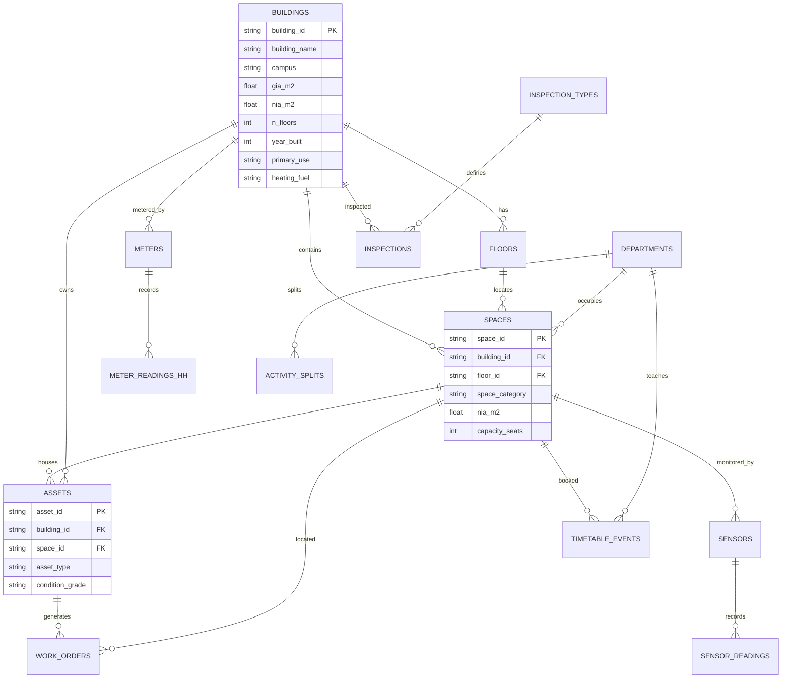

# DATA_MODEL — truth model + export map (synthetic)

## ER diagram (truth tables, clean)

## Truth tables

| Table | Grain | Key | Notes |
|---|---|---|---|
| buildings | 1 row/building | building_id B001… | B003/B005 teaching, B007 office, B012 lab, B019 residential (planted) |
| floors | 1 row/floor | floor_id F-B001-L00 | |
| departments | 1 row/dept | department_id D-ENG… | D-ENG low FTE → high m²/FTE |
| spaces | 1 row/space | space_id S-B001-L02-014 | sum NIA ≤ GIA; 60% have IFC GUID |
| assets | 1 row/asset | asset_id A-B001-000123 | age→condition; `uniclass_code_true` is DEV_PLACEHOLDER only |
| work_orders | 1 row/WO | wo_id WO-0000001 | PPM/Reactive/Statutory/Project; B012 boiler ≥10 reactive |
| inspection_types | 1 row/type | inspection_type_id | frequencies illustrative config (verify before real use) |
| inspections | 1 row/inspection | inspection_id | legionella overdue ×3, failed remedial ×2 planted |
| meters | 1 row/meter | meter_id M-B001-E01 | E=electricity HH, G=gas HH, W=water daily |
| meter_readings_hh | 1 row/meter×HH | (meter_id, ts_utc) | UTC; B007 overnight, B019 summer, M-B015 flatline planted |
| weather | 1 row/HH | ts_utc | temp + HDD(15.5)/CDD |
| academic_calendar | 1 row/date | date | Autumn/Spring/Summer/Holiday, teaching_week |
| timetable_events | 1 row/event | event_id | 09–18 Mon–Fri teaching weeks; B003 dense + small groups |
| sensors | 1 row/sensor | sensor_id SN-… | co2/temp/occupancy_count per room |
| sensor_readings | 1 row/sensor×15min | (sensor_id, ts_utc) | CO₂ first-order to occupancy; B005 poor vent; SN-0042 drift |
| cost_pools | 1 row/pool×year | pool_id | rates/utilities/cleaning/maintenance/security |
| activity_splits | 1 row/dept | department_id | teaching/research/other % |

## Export map (messy raw layer → truth)

| Export file | Format & mess | Truth table(s) |
|---|---|---|
| space_register_YYYYMMDD.xlsx | sheets/campus, merged headers, names not IDs, mixed spellings, "m2/sqm" text, blanks | spaces + buildings |
| cafm_workorders_YYYYMMDD.csv | renamed headers, 3 date formats, inconsistent status, "£1,234.56", duplicates, completed=raised | work_orders |
| meter_hh_supplierA_YYYYMMDD.csv | long, local time dd/mm/yyyy, gaps | meter_readings_hh (electricity) |
| meter_hh_supplierB_YYYYMMDD.csv | wide 48 cols/day, local dates | meter_readings_hh (gas) |
| bms_trends_YYYYMMDD.csv | wide 1 col/point, ISO+offset, "N/A", units in header | sensor_readings (subset) |
| statutory_inspections_YYYYMMDD.xlsx | free-text results, Excel serials + text dates | inspections |
| timetable_YYYYMMDD.csv | "09:00-11:00", weeks "1-10,12" | timetable_events |
| sensors_YYYYMMDD.parquet | tidy + drift/stuck/dropout | sensor_readings |
| ground_truth.yaml | planted findings + defect log (table, row_key, type) | evaluation for P03/P16/P17 |

Time rule: truth UTC; CAFM/meter exports Europe/London (DST 46/50 days deliberate).
