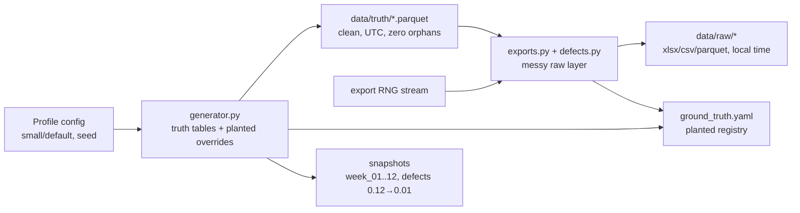

# campus_synth — synthetic campus generator (foundation)

> **All data is synthetic. No real buildings, people, or performance data. Every downstream chart must carry "Synthetic data for portfolio demonstration."**

## 1. Problem statement

Estates analysts need realistic, linked space/asset/meter/BIM-like data to build pipelines and dashboards, but real registers cannot be published. `campus_synth` gives every portfolio project the same deterministic campus (same building IDs, same planted faults) so P01–P20 tell one coherent story without touching any private source. It supports hiring-panel review: reproducible, honest, and fast in CI.

## 2. Architecture



## 3. Data: sources, licences, synthetic note

100% synthetic (numpy RNG + Faker-style names built in; no external download). No standards codes embedded: `uniclass_code_true` is `DEV_PLACEHOLDER_*` only; inspection frequencies are illustrative config; emission factors/Uniclass/COBie/HESA not used here. See root `DATA.md` (no external rows) and `docs/OPEN_QUESTIONS.md` (P10–P17 gaps).

## 4. Quick start (max 3 commands)

```bash
pip install -e ".[dev]"
make data PROFILE=small        # truth + raw + ground_truth.yaml (~20 s)
make snapshots                 # 12 weekly snapshots for P03
```

Direct CLI:

```bash
python -m campus_synth.cli generate --profile small --seed 42 --out data/raw --defects 0.03
python -m campus_synth.cli snapshots --weeks 12 --out data/raw_snapshots
```

Full profile: `make data PROFILE=default` (~4.5M HH rows, <1.5 GB; not run in CI).

## 5. Results

Small profile, seed 42, measured 2026-10-03 (Windows, Python 3.13):

- `generate_all` truth only: **7.9 s**; full `generate` + exports: **17–20 s** (<30 s target).
- Rows: buildings 8, spaces 500, assets 1,496, work orders 6,000, meters 16, HH readings 69,120, timetable 12,488, sensors 90, sensor readings 777,600.
- Truth Parquet total ~3.7 MB; raw exports ~7 MB.
- Tests: **20 passed**; coverage **96% total** (generator 98%, defects 100%, exports 97%, schemas 100%).
- `ruff check` + `ruff format --check` clean; `mypy` strict clean.
- Determinism: same seed → identical hashes (buildings/spaces/assets/meters); seed 43 differs.
- DST: 2025-03-30 local day 46 periods, 2025-10-26 50 periods; small-window 2026-03-29 46.
- Planted findings: all `applies=True` findings detected in tests (B007 ratio 0.45–0.75, B012 ≥8 reactive, D-ENG ≥1.3× median, legionella ≥3 overdue + ≥2 failed remedial, B005 CO₂, SN-0042 drift, IFC 12+5). Default-only findings verified by targeted generation. See `docs/ACCEPTANCE_F.md`.

## 6. Design decisions and trade-offs

- **Single seeded `numpy.random.Generator`** for all randomness; export mess uses a separate stream (`seed+999`) so truth hashes are seed-pure. Fixed window end 2026-03-31 for reproducibility.
- **Truth clean / raw messy split**: integrity tests run on truth (zero orphans, NIA ≤ GIA); defects only in exports and logged to `ground_truth.yaml`. Keeps DQ evaluation honest.
- **Vectorised profiles**: electricity = base + occupancy×day + noise by building use (labs high base, libraries long hours, residences evening peak); gas = base + HDD; CO₂ via EWMA first-order to occupancy (fast; avoids per-step loops). Trade-off: less physical fidelity than EnergyPlus, but runs in seconds and plants clear signals.
- **UTC store, local export**: truth UTC; CAFM/meter exports Europe/London (deliberate 46/50 DST days, ambiguous local times, £/date mess). Documents real integration pain.
- **Small trims meters/sensors** (16 meters, 30 rooms) for <30 s; default scales to 130 meters/150 rooms. Timetable capped by teaching-day sampling; sensor CO₂ via EWMA not per-step Python.
- See `docs/adr/` for stack notes (Python 3.11+ vs spec 3.12; hatch force-include for `packages/` layout).

## 7. Data quality and testing approach

- `tests/test_determinism.py`: same seed → same hashes; different seeds differ.
- `tests/test_schema.py`: Pydantic v2 validates every truth table (200-row sample) + negative case.
- `tests/test_integrity.py`: zero orphans across all FKs; space NIA ≤ building GIA.
- `tests/test_defects.py`: injected counts == log counts; catalogue types; zero-rate clean.
- `tests/test_dst.py`: known 2025 DST days + small-window spring-forward integration.
- `tests/test_planted.py`: per-finding assertions with tolerances; default-only via targeted fast generation.
- `tests/test_cli.py`: end-to-end `generate` + `snapshots` to tmp dirs (covers cli/exports/ground_truth).
- Coverage gate: core modules ≥80% (measured 96% total). `make ci` = lint + type + test + small generate.

## 8. Limitations and next steps with real data

- Loads are synthetic shapes, not calibrated to any estate; tariffs, EPCs, and inspection frequencies are illustrative — verify against DESNZ/legal sources before real use (see `OPEN_QUESTIONS.md`).
- No geometry: IFC recon lists are ID lists for P11 to realise with IfcOpenShell; no CAD parsing here.
- `DEV_PLACEHOLDER` Uniclass must be replaced by NBS fetch in P13; COBie/ISO19650/HESA mappings belong to P10/P12/P14 with official specs.
- With real data: swap generator for P01 bronze/silver loaders, keep contracts/schemas/DQ checks, add lineage (P04 dbt) and orchestration (P02 Airflow).

## 9. Skills demonstrated

E3 (data modelling: 17-table truth + ER), E4 (integration: 7 messy source shapes + local/UTC + crosswalks), E6 (quality: defect catalogue + ground-truth evaluation), D5 (reproducibility: seeded, pinned, CI).
