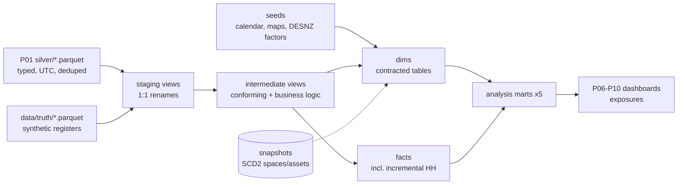

# P04 dbt project — estate data models (staging → intermediate → marts)

> **Synthetic data for portfolio demonstration. No real building performance, carbon figures or compliance status is implied.**

## 1. Problem statement

P01 produces clean silver tables, but analysts still need conformed dimensions, business logic in one tested place, and gold marts the Power BI dashboards (P06–P10) can trust. This dbt project is that layer: it turns eight silver extracts plus synthetic truth registers into documented, contracted, tested marts with full lineage.

## 2. Architecture



Lineage: every mart documents its upstream refs; `dbt docs generate` publishes the DAG (see `docs/ACCEPTANCE_P04.md`).

## 3. Data: sources, licences, synthetic-data note

All inputs are synthetic: P01 silver (from `campus_synth`, seed 42) and `data/truth/` registers. The sole external input is the **DESNZ 2025 GHG conversion factors workbook** (Open Government Licence v3.0), downloaded by `scripts/fetch_desnz.py` — never hard-coded. See root `DATA.md`. Every mart description carries a synthetic-data note.

## 4. Quick start (max 3 commands)

```bash
pip install -e ".[dev]"
make ingest && make dbt-build
```

Direct:

```bash
python platform/dbt/scripts/build_seeds.py
dbt build --profiles-dir platform/dbt --project-dir platform/dbt
dbt docs generate --profiles-dir platform/dbt --project-dir platform/dbt
```

Always run from the repo root (DuckDB paths resolve against the working directory).

## 5. Results

Small profile, seed 42 (full numbers in `docs/ACCEPTANCE_P04.md`):

- `dbt build` green: **196 pass, 0 errors** (~19 s), full-refresh and incremental re-run both green.
- **147 data tests + 2 dbt unit tests** (hand-checked fixtures); 11 singular business-rule tests.
- Coverage: **41/41 models with ≥ 1 test (100%)**, **292/292 columns documented (100%)**, **21/21 marts contracted**.
- Reconciliation: silver → marts fully explained (e.g. meter HH 68,119 → 67,758: 297 defect-meter + 64 out-of-window rows dropped; timetable 12,347 → 12,026: 286 quarantined-space + 36 future-date rows, 1 overlap).
- `sqlfluff` clean; `dbt docs` catalog generates.

## 6. Design decisions and trade-offs

- **Sources are virtual**: `source()` renders to Parquet paths via `meta.external_location` (no warehouse views to maintain). Consequence: dbt unit tests cannot take `source()` fixtures (adapter introspection), so unit tests target `ref()` inputs instead — documented in `ACCEPTANCE_P04.md`.
- **Facts conform by inner join** (defect meters, quarantined spaces, out-of-window dates dropped) rather than preserving orphans. Rationale: gold must be analysis-ready; drops are counted and reconciled, and P03 owns defect detection.
- **Space conforming in `int_current_space`**: silver uses room codes (`B…`), timetable/assets/sensors use canonical truth IDs (`S-B…`); the intermediate joins the truth master so `dim_space` has one canonical grain. Trade-off: needs truth at build time (in production this would be a master-data table).
- **`dim_date` stays term-bounded** (calendar seed, 90 days); facts are filtered to the synthetic window ending 2026-03-31 instead of extending the dimension to defect dates (2099).
- **Negative `remaining_life_pct` is valid** (asset beyond expected life = backlog), so the sanity test only flags impossible values (negative age, >100% remaining).
- No `dbt_utils`/`dbt-expectations` packages (avoids network `dbt deps`); built-in generics + singular tests cover the same ground.

## 7. Data quality and testing approach

- Generic tests on every model (not_null, unique, relationships, accepted_values); singular SQL for business rules (NIA ≤ GIA, teaching capacity, meter grain, chronology, carbon coverage, no-negative-energy, DST period counts).
- 2 dbt unit tests with hand-checked fixtures (work-order enrichment, carbon math).
- Contracts enforced on all 21 marts; freshness checks on event-time sources (`dbt source freshness`: 1 pass, 3 warn — expected, synthetic window ended 2026-03-31).
- SCD2 snapshots on spaces/assets; incremental `fct_meter_hh` with 7-day lookback verified by full-refresh + incremental re-run.

## 8. Limitations and next steps with real data

- Default (full-volume) profile not yet run end-to-end — do before P02 backfill claims; expect to tune threads/memory.
- Freshness thresholds are illustrative for the synthetic window; tighten to ~36 h for real feeds (P02 adds ingest timestamps, P03 owns timeliness).
- DESNZ factors are single-year (2025); add a year-coverage test and fallback rule per the P08 spec when multi-year reporting lands.
- `dim_trade` is derived from observed trade names; link to real SFG20-style task templates in P07 (generic templates only — SFG20 is commercial).

## 9. Skills demonstrated

E2 (multi-source modelling, incremental load), E4 (contracts, lineage, exposures, docs), E6 (80+ tests, unit tests, SCD2, reconciliation), E7 (idempotent re-runs, freshness), D3 (DQ scorecard mart, quarantine-aware facts), D4 (published docs, exposures for consumers).
