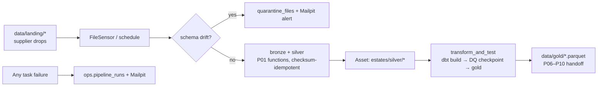

# P02 Orchestrated ETL (Airflow 3.3.1)

> **Synthetic data for portfolio demonstration. No real building performance
> or compliance status is implied.**

## 1. Problem statement

Five estates extracts land on different cadences from different "suppliers".
Someone must watch for files, validate them against contracts, load them
idempotently, rebuild the dbt marts when data arrives, and shout loudly on
failure — without one broken feed blocking the others. That is this project.

## 2. Architecture



## 3. Data: sources, licences, synthetic-data note

Inputs are the synthetic `campus_synth` extracts (see root `DATA.md`).
Landing files are copies of `data/raw` made by `scripts/demo_drop.py`.
All outputs carry the synthetic-data note.

## 4. Quick start (max 3 commands)

```bash
make airflow-up
python platform/orchestration/scripts/demo_drop.py --scenario good
make airflow-backfill
```

UI http://localhost:8080, Mailpit http://localhost:8025. Full operator guide:
`docs/runbook.md`.

## 5. Results

See `docs/ACCEPTANCE_P02.md`: 7/7 DAGs import clean, good-file run green,
corrupt-file run quarantined + Mailpit alert with other DAGs unaffected,
30-day `ingest_meter_hh` backfill complete, `ops.pipeline_runs` exported to
`docs/pipeline_runs.csv`, UI screenshot placeholder `docs/img/airflow_runs.png`.

## 6. Design decisions and trade-offs

- **One DAG per source**: a failing feed blocks only itself (spec requirement).
- **Checksums, not timestamps**, give idempotency (P01 bronze manifest);
  CAFM adds a watermark so hourly runs skip seen files fast.
- **Dynamic mapping** (`.expand()`) for meter/BMS files; FileSensor only where
  a wait is semantically needed (space register).
- **Asset-aware `transform_and_test`** (`schedule=[...]`) instead of timers.
- **Callbacks never raise**: ops write + SMTP are wrapped; a dead Mailpit
  must not fail tasks. See `docs/adr/002-orchestrator-choice.md`.

## 7. Data quality and testing approach

- `tests/test_task_funcs.py`: drift clean/dirty/unreadable, quarantine,
  watermark, ops store, alerting, housekeeping (host-runnable, no airflow).
- `tests/test_dagbag.py`: zero import errors, ≥7 DAGs (CI/Linux).
- `tests/test_dag_contract.py`: retries, `doc_md`, owner, tags, callbacks,
  `max_active_runs` on every DAG.

## 8. Limitations and what I would do next with real data

- Demo passwords, single-node Celery, no TLS/auth hardening — local demo only.
- Landing is a shared folder; production would use S3 event sensors +
  managed Airflow with Secrets Backends.
- DQ checkpoint is a P03 hook (skip-notice until P03 lands).
- Bronze partitioning by `ingest_date` is not yet pruned by housekeeping.

## 9. Skills demonstrated

E2 (orchestrated heterogeneous ingestion), E7 (retries, backfills, alerting,
runbooks), D2 (asset-aware scheduling, monitoring via ops store), D3 (DQ gate
hook, quarantine reporting).
