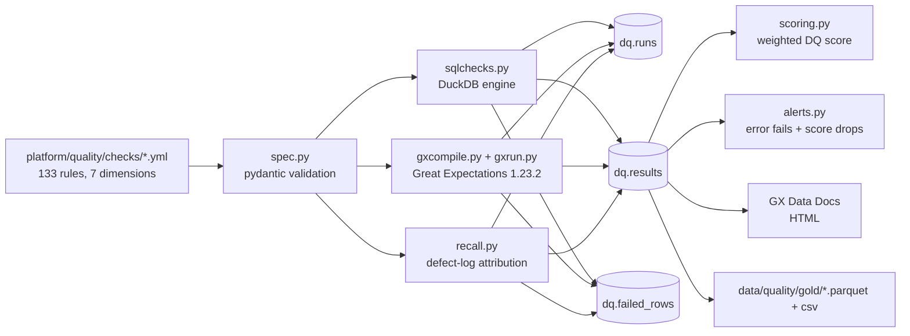

# P03: Data quality framework (YAML → GX + SQL, scoring, trend, alerts)

> **Synthetic data for portfolio demonstration. No real building performance or compliance status is implied.**

## 1. Problem statement

Estate data arrives with messy names, bad dates, orphan foreign keys, flat-lined meters and silent feed gaps. Without a systematic quality layer, downstream dashboards (P06–P10) and dbt marts (P04) trust row counts that are wrong. P03 turns every check into a named, YAML-declared rule with deterministic recall against the defect log, a weighted DQ score, GX Data Docs, and CI gates.

## 2. Architecture



## 3. Data: sources, licences, synthetic note

Inputs: `data/lakehouse/silver/*` (typed, UTC, deduped), `data/lakehouse/quarantine/*`, `data/truth/*` (clean reference), `data/raw/ground_truth.yaml` (defect log), `data/raw_snapshots/week_01..12` (weekly trend fixtures). All synthetic via `campus_synth`. No external licences.

## 4. Quick start (max 3 commands)

```bash
pip install -e ".[dev]"
python -m campus_synth.cli generate --profile small --seed 42 --out data/raw --defects 0.03
python -m ingest.cli run-all --raw data/raw --out data/lakehouse --truth data/truth
python -m quality.cli run --label small --run-id r1
```

Trend scoring over the 12 weekly snapshots:

```bash
python -m quality.cli trend --weeks 12
```

## 5. Results (small profile, seed 42, measured 2026-10-05)

133 checks across 10 datasets (assets, spaces, work orders, sensors, BMS, meters A/B, inspections, timetable, snapshots):

| Dataset | Checks | DQ score |
|---|---|---|
| assets | 10 | ≥ 95 |
| spaces | 15 | ~99.9 |
| work_orders | 23 | ~95 |
| meters_a | 18 | ~83 |
| meters_b | 18 | ~83 |
| sensors | 14 | ~93 |
| bms | 7 | ~92 |
| inspections | 9 | ~100 |
| timetable | 16 | ~93 |
| spaces_snapshot | 4 | ~96 (week_01) → ~99 (week_12) |

Recalls (planted defect detection):

| Type | Sites | Recall |
|---|---|---|
| nulls_in_mandatory | 7 datasets | 100% (or overlap-union with first-rule quarantine) |
| duplicate_rows | 6 datasets | 100% |
| out_of_range | 6 datasets | 100% (quarantine or silver leak check) |
| misspelt_category | 6 datasets | 100% (quarantine, silver pattern, or absent-from-bronze) |
| future_dates | 4 datasets | 100% |
| orphan_fk | 2 datasets | 100% |
| completed_before_raised | 1 dataset | 100% |
| gaps | 1 dataset | 100% (via P01 gaps report) |

`dq.failed_rows` stores up to 100 sample rows per check. `dq.alerts` records every `error`-severity failure and any score drop > 5 points vs trailing mean.

## 6. Design decisions and trade-offs

- **GX 1.23.2 verified empirically** (2026-10-05): pandas runtime batches, suites, ValidationDefinition.run, Data Docs. Never relied on memory.
- **SQL engine for volume**: GX covers registers/transactions; DuckDB checks cover 774k sensor rows, BMS wide-long melting, gap runs, spike medians, DST counts, volume ±3σ, reconciliation, and recall rules. Same YAML, same results schema.
- **Recall granularity is defect-log-native**: unique keys get exact key matching; repeated keys get key-presence (sensors) or grain-excess (meters) rules; masked `xx` keys get count rules; wide supplier-B counts divide by 48; bms N/A cells are aggregated. Tier-2 bronze cross-match attributes multi-hit overlaps when a shortfall appears.
- **Window-end pinned at 2026-04-01** rather than wall-clock now, so the frozen synthetic window has stable timeliness results.
- **GX `mostly` = threshold / 100**, so a 98% threshold becomes a 2% allowed failure rate.
- **Quarantine reason decides which planted defect is "detected"**: overlap-safe — a row quarantined under the first-hitting rule still counts for its planted type. Documented in OPEN_QUESTIONS #11 context.

## 7. Data quality and testing approach

- `platform/tests/test_dq_spec.py` (9 tests): YAML load, threshold mapping, unknown expectation/kwarg rejection, index collision, value_set_from resolution.
- `platform/tests/test_dq_sqlchecks.py` (21 tests): every SQL check evaluated against hand-built fixtures with hand-computed expected (checked, failed) pairs; by_building pairs; scalar timeliness cases.
- `platform/tests/test_dq_recall.py` (6 tests): exact-key union, masked count, blank-row rule, artifact rules, unknown-rule error.
- `platform/tests/test_dq_scoring.py` (8 tests): weighted score maths, dimension/building splits, alert error-fail and score-drop logic.
- **ruff + mypy clean** on `platform/src/quality` and `platform/tests`.

## 8. Limitations and next steps with real data

- Assets and inspections truth tables have no source register yet; those checks run on the reference data and would wire to silver once P02/P07 ingest them.
- BMS has no dedupe in P01 exports — `bms_grain_dup_rate` is a warn-level tripwire.
- No P03 checks for `activity_splits`, `cost_pools`, `floors`, `departments` (not used by P06–P10 marts yet).
- Real timeliness needs event-time vs wall-clock separation; the 36h/90d thresholds are illustrative.

## 9. Skills demonstrated

E6 (DQ framework design, 7 dimensions, scoring, trend, alerts), E7 (recall evidence, Data Docs), D3 (CI-gateable error failures, documented fixtures), plus reused P01 contracts, P04 gold marts, and the synthetic window guarantees.
