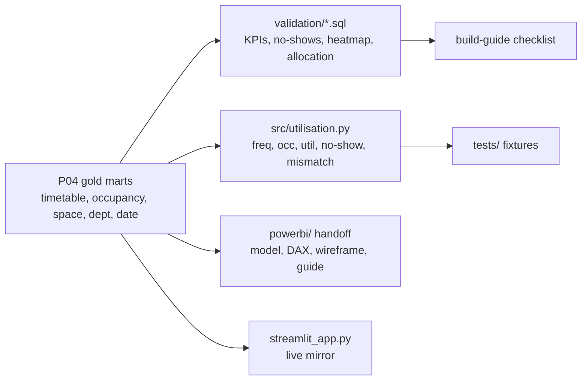

# P06 Space utilisation

> **Synthetic data for portfolio demonstration. No real room usage is implied.**

## 1. Problem statement

Timetabling, space managers and faculties need to know which rooms are booked but empty, how space per person compares across departments, and what could be released at a target utilisation. This project computes SMG-style frequency × occupancy from gold marts plus observed sensor counts, and prepares everything for a Power BI build.

## 2. Architecture



## 3. Data: sources, licences, synthetic-data note

All inputs synthetic (`campus_synth` seed 42 via P01/P04; truth dept mapping for allocation). No external data. Footer on every page.

## 4. Quick start (max 3 commands)

```bash
pip install -e ".[dev]"
make p06-run
streamlit run projects/p06-space-utilisation/streamlit_app.py
```

## 5. Results

Small profile, seed 42 (`docs/findings.md`):

- 495 spaces, 24,052 booked hours: frequency **8.4%**, occupancy **15.7%**, utilisation **4.2%**.
- B003 teaching: booked ~55% but ~21% full — planted pattern present below the spec's 70% line (0 rooms ≥70%; all 30 <30% occupied).
- D-ENG 247.5 m²/staff-FTE vs 64.3 median (**+285% measured**, not spec ≈40% — reported as measured).
- 3 no-shows of 3,336 covered events (~0%); **6,704 capacity mismatches (56%)** — the actionable story.

## 6. Design decisions and trade-offs

- **No-show needs coverage**: events without sensors are unknown, never no-shows; negatives excluded as invalid.
- **Dept mapping at P06 level** (truth spaces) until `dim_space` carries departments — documented in model.md.
- **Reported, not forced**: both planted findings deviate from spec magnitudes; filters document how to see them, numbers stay measured.

## 7. Data quality and testing approach

- `tests/test_utilisation.py`: hand fixtures incl. the 1-room-3-events acceptance case.
- `validation/v01–v05.sql`: every headline KPI reproducible; v02 joins 249k sensor readings to event windows DST-safely.
- Coverage gaps (28% sensor coverage, 222 invalid readings) quantified in findings.

## 8. Limitations and next steps with real data

- Single quarter; attendance proxies (group size) need register/door-count validation in production.
- Promote dept mapping + no-show flag into dbt marts when the platform stabilises.
- Real RLS per building manager (see P07 pattern).

## 9. Skills demonstrated

E5 (utilisation analytics), E6 (fixture-tested KPIs, DST-safe joins), D5 (Power BI handoff), D3 (coverage-aware no-show logic, quarantine-aware facts).
