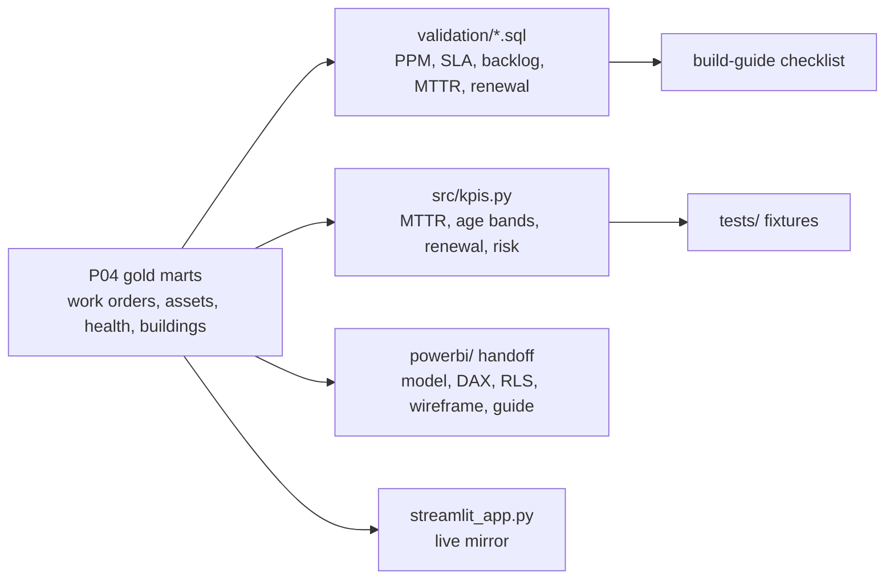

# P07 Asset & maintenance performance

> **Synthetic data for portfolio demonstration. No real asset or maintenance data is implied.**

## 1. Problem statement

Estates and facilities managers need to know where the maintenance backlog sits, which assets keep failing, what must be replaced over the next five years, and whether planned maintenance is keeping up with reactive work. This project computes CAFM-style KPIs from the gold marts (`fct_work_order`, `dim_asset`, `mart_asset_health`, `dim_building`, `dim_trade`) and prepares a full Power BI handoff with row-level security.

## 2. Architecture



## 3. Data: sources, licences, synthetic-data note

All inputs synthetic (`campus_synth` seed 42 via P01/P04). The task-template library (`templates/task_templates.csv`) is a synthetic, generic SFG20-style example — **not SFG20 content** (commercial licence). SLA targets are illustrative config. No external data. Footer on every page.

## 4. Quick start (max 3 commands)

```bash
pip install -e ".[dev]"
make p07-run
streamlit run projects/p07-asset-maintenance/streamlit_app.py
```

## 5. Results

Small profile, seed 42 (`docs/findings.md`):

- 4,938 WOs; PPM completion **93.0%**; planned:reactive **1.88**; reactive MTTR **3.17 days**; £1.59M cost.
- Backlog 327 open, 323 aged 0–30 days (3-month window, as-of window end).
- SLA met: P1 23.7%, P2 65.2%, P3 85.1%, P4 97.2%.
- Bad actors: B003 Autoclave and B006 Pump lead with 8 reactive jobs each; 169 repeat-failure assets.
- Condition mix 288 A / 440 B / 485 C / 283 D; 373 assets over expected life.
- 5-year renewal forecast 2026–2030: **£2.11M** (~£420k/yr).
- PPM completion March dip: **79.4%** (measured; the planted 2025-Q4 drop needs the default profile).
- Planted B012 boiler: **not present on small profile** (B001–B008 only) — reported, not forced.

## 6. Design decisions and trade-offs

- **SLA targets are config, not data**: the gold schema has no SLA table; targets (P1 1d, P2 5d, P3 10d, P4 20d) are labelled illustrative in `methodology.md` and the build guide.
- **No fault-code column**: the Pareto defaults to trade/asset type; documented in findings and wireframe.
- **Backlog as-of = window end** (2026-03-31): ages are young by construction; stated in methodology.
- **Reported, not forced**: both planted findings (B012 boiler, 2025-Q4 PPM drop) require the default profile; measured analogues are documented instead.

## 7. Data quality and testing approach

- `tests/test_kpis.py`: hand-checked fixtures for MTTR, backlog age banding (boundary table), renewal forecast, SLA/MTBF/PPM, remaining life, risk band.
- `validation/v01–v05.sql`: every headline KPI reproducible against `data/warehouse.duckdb`.
- RLS design with "View as" test cases in `powerbi/build-guide.md` §3.

## 8. Limitations and next steps with real data

- One quarter of WOs; 12-month metrics use the trailing window available.
- Cost per m² (~£0.025) is an artefact of the 3-month cost window vs whole-asset GIA — flagged, not hidden.
- With real data: load actual SFG20 schedules under licence, add fault codes, real SLA table, and CAFM integration.

## 9. Skills demonstrated

E5 (maintenance analytics), E6 (fixture-tested KPIs, validation SQL), D5 (Power BI handoff with RLS), D7 (CAFM-style asset data, lifecycle forecasting).
