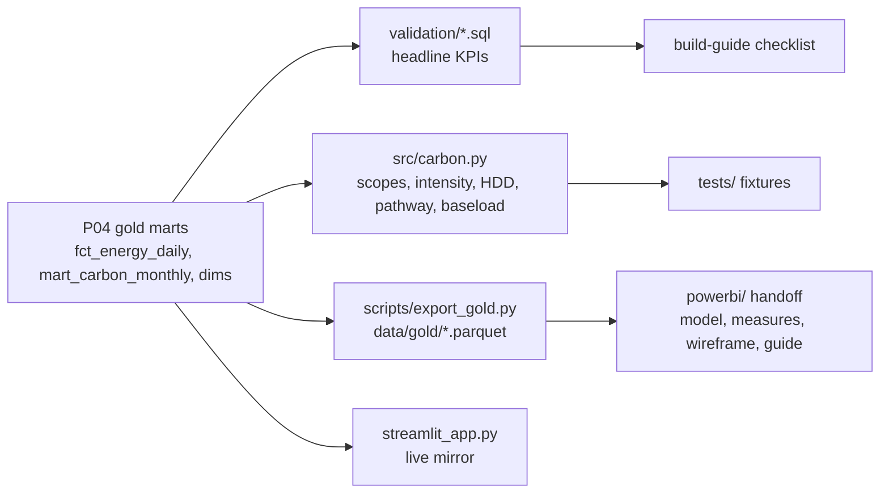

# P08 Net zero & carbon

> **Synthetic data for portfolio demonstration. No real building performance or emissions are implied.**

## 1. Problem statement

Estates and sustainability teams need to know whether the campus is on a net-zero pathway, which buildings drive emissions, and where energy is wasted out of hours — from trusted, reconciled meter data rather than spreadsheets. This project turns P04 gold marts into scope-based carbon accounts, intensity league tables, a pathway variance view and a baseload analysis, with everything a human needs to build the Power BI dashboard in 1–3 hours.

## 2. Architecture



## 3. Data: sources, licences, synthetic-data note

All energy/meter data is synthetic (`campus_synth`, seed 42, via P01/P04). External inputs: DESNZ 2025 GHG factors (OGL v3.0, in the gold seed — root `DATA.md`) and the GHG Protocol Corporate Standard + Scope 2 Guidance scope definitions (referenced, not reproduced). Every dashboard page carries a synthetic-data footer.

## 4. Quick start (max 3 commands)

```bash
pip install -e ".[dev]"
make p08-run
streamlit run projects/p08-net-zero-carbon/streamlit_app.py
```

Gold extracts: `python projects/p08-net-zero-carbon/scripts/export_gold.py` (after `make dbt-build`).

## 5. Results

Small profile, seed 42 (see `docs/findings.md` for full numbers):

- Scope 1: 258,943 kWh → **52,488 kgCO2e**; Scope 2: 609,043 kWh → **107,801 kgCO2e**.
- **B007 tops both rankings**: intensity 1.9872 kgCO2e/m² and baseload 48.8% of peak — planted finding #1 confirmed.
- Planted finding #2 (B019 summer heating) is **not verifiable** on small (no B019, no summer months); exact default-profile filters documented instead of assumed.
- 7 calculation unit tests pass; 4 validation queries reproduce every headline KPI.

## 6. Design decisions and trade-offs

- **P08 adds no dbt models**: pathway/baseload/intensity are computed in `src/` + validation SQL over existing marts, keeping P08 independent of the in-flight platform work.
- **Facts over forecasts**: mart baselines are NULL (no base-year data), so the dashboard pathway uses a user baseline parameter rather than a fabricated baseline.
- **HDD normalisation is indicative**: single-quarter data gives a weak weather signal; methodology states the linear-HDD assumption and its limits.
- **Market-based Scope 2 is a labelled placeholder**, never mixed into location-based totals.

## 7. Data quality and testing approach

- `tests/test_carbon.py`: hand-checked fixtures for every function (including the 1-meter-1-month acceptance fixture).
- `validation/v01–v04.sql`: each headline KPI reproducible from gold; mart↔fact cross-checks (scope sums tie within rounding).
- Defect-aware: facts already conform at P04; P08 documents which planted defects were excluded upstream.

## 8. Limitations and next steps with real data

- Q1-only window: no summer, no heating-season comparison, 12-month rolling is partial — re-run on the default profile.
- Single DESNZ factor year; add year-coverage + fallback per the P08 spec for multi-year reporting.
- Real deployment needs sub-meter coverage checks, data-center exclusions, and green-tariff evidence for any market-based claim.

## 9. Skills demonstrated

E5 (carbon accounting from meter data), E6 (fixture-tested calculations, validation SQL), D5 (Power BI handoff: model, DAX, wireframe, build guide), D7 (DESNZ/GHG provenance), D8 (pathway, intensity, baseload analysis).
