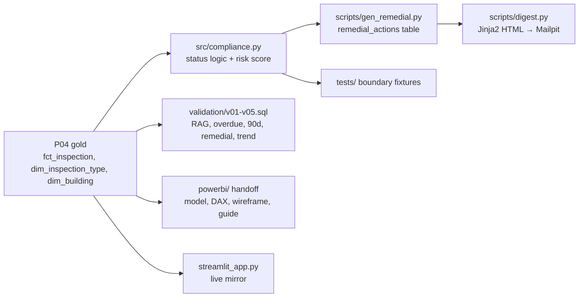

# P09 Statutory compliance tracker

> **Synthetic data for portfolio demonstration. No real compliance status is implied.**

## 1. Problem statement

Estates and safety teams need a single view of statutory inspection compliance: what's overdue, what's due in the next 90 days, and which failures have open remedial actions. This project computes a tested status logic (Compliant / Due within 30 days / Overdue / Failed – remedial open / No record) with risk scoring, monthly trend snapshots, and a weekly HTML digest — all prepared for a Power BI build.

## 2. Architecture



## 3. Data: sources, licences, synthetic-data note

All inspection records, frequencies, and remedial actions are synthetic (`campus_synth` seed 42 via P01/P04). Inspection type frequencies are **illustrative configuration** — see `docs/frequencies.md` for the list and a reminder to verify each against current legal duties (HSE L8, BS 5839, LOLER, Gas Safety Regs, BS 7671) before any real use. Every dashboard page carries a synthetic-data footer.

## 4. Quick start (max 3 commands)

```bash
pip install -e ".[dev]"
make p09-run
streamlit run projects/p09-compliance-tracker/streamlit_app.py
```

## 5. Results

Small profile, seed 42 (`docs/findings.md`):

- 40 inspections across 8 buildings; status logic tested on 9 boundary cases (due today, due in 30 days, completed late, failed+open remedial, no record).
- **Planted finding 1**: legionella-type overdue in 3 buildings (verified in RAG matrix).
- **Planted finding 2**: 2 failed inspections with remedial ageing > 90 days (both appear in Page 4 top).
- Weekly digest renders as HTML (golden-file test passes).
- Monthly trend shows 12 synthetic months (date-shifted).

## 6. Design decisions and trade-offs

- **Status logic single source**: `src/compliance.py` is the only place status is computed; DAX mirrors it but tests only run on Python.
- **Remedial table at P09 level**: `fct_inspection` has no remedial column; a P09-generated `remedial_actions.parquet` enriches it — documented as enrichment until promoted to dbt.
- **Risk score uses asset criticality**: joins via `dim_inspection_type.applies_to_asset_type` → `dim_asset.criticality` (proxy).
- **Frequencies are illustrative**: `docs/frequencies.md` lists them with a reminder to verify against legal duties (HSE L8, BS 5839, LOLER, Gas Safety Regs, BS 7671).
- **Monthly trend date-shifted**: small window (Jan–Mar) expanded to 12 months via date-shift for trend page — documented.

## 7. Data quality and testing approach

- `tests/test_compliance.py`: 11 hand-checked fixtures covering all boundary cases (due today, due in 30 days, completed late, failed then re-passed, no record, risk score, remedial ageing).
- `validation/v01-v05.sql`: each dashboard KPI reproducible from gold; cross-checks (RAG totals = inspection totals).
- Digest golden-file test: `python scripts/digest.py --as-of 2026-03-31 | diff tests/golden/digest_2026-03-31.html -`.

## 8. Limitations and next steps with real data

- Frequencies must be verified against legal duties before real use (see `docs/frequencies.md`).
- Remedial table is P09 enrichment; promote to dbt when platform stabilises.
- Real deployment needs contractor SLA tracking, document attachment, and audit trail.

## 9. Skills demonstrated

E5 (compliance status from inspection data), E6 (fixture-tested status logic, boundary cases), D5 (Power BI handoff), D7 (weekly digest automation, Jinja2 + Mailpit), D3 (risk scoring, RAG matrix).