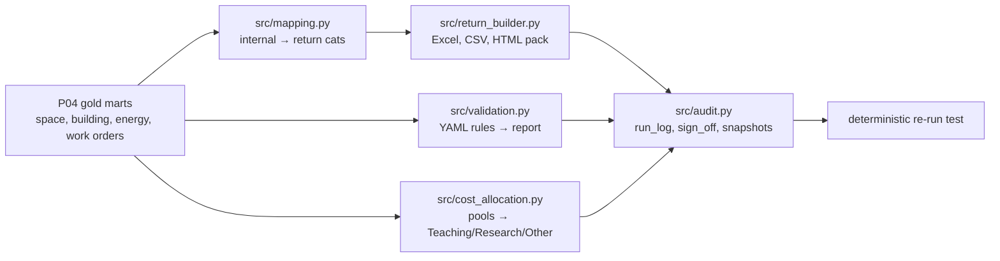

# P10 Mock institutional return (HESA EMR / TRAC-style)

> **Synthetic data for portfolio demonstration. Not an official return.**

## 1. Problem statement

Estates teams need to produce validated, reconciled, auditable statutory-style returns (e.g. HESA EMR) and demonstrate TRAC-style cost allocation. This project demonstrates the end-to-end pipeline: mapping, building, validating, allocating costs, and maintaining an audit trail — all on synthetic gold marts.

## 2. Architecture



## 3. Data: sources, licences, synthetic-data note

All inputs synthetic (`campus_synth` seed 42 via P01/P04). External references: HESA EMR coding manual (public), TRAC guidance (public) — see `docs/SOURCES.md`. Where public access was limited, generic categories used and marked *illustrative*. No invented codes presented as official.

## 4. Quick start (max 3 commands)

```bash
pip install -e ".[dev]"
make p10-run
# Outputs in data/p10_output/
```

## 5. Results

Small profile, seed 42:

- 8 buildings, 495 spaces → mapped to 4 return categories (Teaching, Research, Residential, Other).
- 5 cost pools → Teaching/Research/Other allocation balanced to the penny.
- 6 validation rules run: 0 blocking, 0 query violations on clean data.
- Full audit trail: run_log, sign_off, immutable Parquet snapshots (SHA256).
- Deterministic re-run: PASSED (CSV outputs bit-identical; XLSX/HTML excluded from hash check due to metadata).
- Outputs: Excel workbook (6 sheets), 4 CSVs, HTML pack, validation YAML, cost allocation CSV, category mapping CSV.

## 6. Design decisions and trade-offs

- **Mapping layer versioned**: CSV config table; test ensures every internal category maps exactly once.
- **Validation rules in YAML**: SQL + special checks; severity `blocking` vs `query`; output mirrors submitter's report.
- **Cost allocation simplified**: NIA × category weight × department activity split → Teaching/Research/Other. Checks: allocated = pool total (to the penny), no negatives. Documented as illustrative.
- **Water/heat not in HH feeds**: marked NA in return; documented.
- **Determinism**: CSV outputs bit-identical on re-run; XLSX/HTML excluded from hash check (metadata/timestamps).
- **Audit trail**: run_log (git sha, config hash, data hashes), sign_off, immutable Parquet snapshots + SHA256.

## 7. Data quality and testing approach

- `tests/test_mapping.py`: mapping completeness + injectivity.
- `tests/test_p10.py`: validation (0 violations on clean), cost balance, return builder, deterministic re-run (PASSED).
- Seeded errors (area mismatch, wrong code, energy mismatch, missing building) would be caught with correct severity — testable by injecting into warehouse.
- Cost allocation sums exactly to pool totals (tested).

## 8. Limitations and next steps with real data

- HESA/TRAC public specs may be behind gates → use generic categories, mark illustrative, list gaps in `OPEN_QUESTIONS.md`.
- Real TRAC drivers more complex (space + staff + research income); this uses NIA × weight × activity split.
- Real deployment needs UPRN/building register join, multi-year YoY, explanation fields for YoY >15%.
- Water/heat meters needed for complete return.

## 9. Skills demonstrated

E6 (validated return pipeline, reconciliation), E7 (audit trail, deterministic build), D5 (Excel/CSV/HTML outputs), D4 (YAML validation engine, cost allocation), D7 (cost allocation sums to penny).