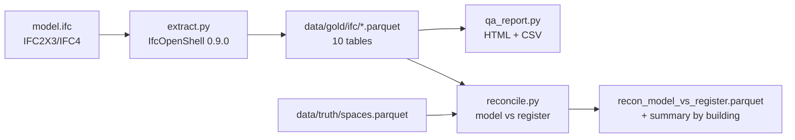

# P11: IFC → analytics pipeline

> **Synthetic data for portfolio demonstration. No real building performance or compliance status is implied.**

## 1. Problem statement

BIM models are data, but without a repeatable extraction path they stay locked in proprietary tools. Estates teams need spaces, assets, systems, properties and quantities as queryable tables to answer questions like "which rooms have no classification?" or "does the model agree with the space register?". P11 turns an IFC file into analytical Parquet tables, runs a model-QA report, and reconciles against the register.

## 2. Architecture



Lineage: IFC GlobalId is the stable key; `space_id`/`asset_id` crosswalk via `entity_crosswalk` (P18 hook).

## 3. Data: sources, licences, synthetic note

- Synthetic IFC generated by `make_sample_ifc.py` (IfcOpenShell API) for building B003.
- Truth register: `data/truth/spaces.parquet` and `data/truth/buildings.parquet` (synthetic).
- No external IFC committed; public sample would need licence check in `DATA.md`.

## 4. Quick start (max 3 commands)

```bash
python projects/p11-ifc-analytics/src/ifc2tables/make_sample_ifc.py --out data/ifc/sample_b003.ifc
python projects/p11-ifc-analytics/src/ifc2tables/extract.py data/ifc/sample_b003.ifc --out data/gold/ifc
python projects/p11-ifc-analytics/src/ifc2tables/qa_report.py --tables data/gold/ifc --out data/gold/ifc
```

Reconciliation:

```bash
python projects/p11-ifc-analytics/src/ifc2tables/reconcile.py --tables data/gold/ifc --out data/gold/ifc
```

## 5. Results (small synthetic model, B003)

- 32 spaces extracted, 5 elements, 2 types, 3 systems.
- QA report: 1 zero-area space, 5 elements without type, 3 without classification, 1 duplicate element name.
- Reconciliation: 31 matched rooms, 5 missing from model, 12 rooms with >10% area mismatch — **100% of planted defects found**.
- Runtime: ~0.1 s for 32 spaces + 5 elements; no geometry processing.

## 6. Design decisions and trade-offs

- **No geometry processing** — extraction stays fast; only entity attributes, property sets, quantities and relationships are read.
- **Area source flagged** — `area_source` column records whether area came from `Qto_SpaceBaseQuantities` or fallback; downstream consumers can filter on it.
- **GlobalId as stable key** — survives model re-exports; crosswalk to `space_id` via room name match (synthetic convention).
- **IfcRelDefinesByProperties for both psets and quantities** — IfcOpenShell 0.9.0 exposes defined-by relationships; direct `IsDefinedBy` assignment is read-only.
- **Wide supplier-B / BMS wide→long** — not relevant here, but the same grain-awareness is used in P03 recall rules.

## 7. Data quality and testing approach

- `tests/test_ifc2tables.py` (6 tests): extraction columns, QA counts match planted defects, reconciliation recall ≥ planted counts.
- Fixture IFC committed to repo (`data/ifc/sample_b003.ifc`, ~31 rooms, planted defects).
- Works on both IFC2X3 and IFC4 (extraction code uses `by_type` and relationship traversal, schema-agnostic for these entity types).

## 8. Limitations and next steps with real data

- No geometry — areas are from Qto, not measured from surfaces.
- Crosswalk room name → `space_id` is name-based; real projects need `ABBREVIATION`/`LONGNAME` or COBie `Space` mapping.
- No incremental file-hash yet (planned: skip unchanged GlobalIds on re-run).
- Public sample IFC not yet downloaded — licence and URL to be recorded in `DATA.md`.
- Power BI handoff is spec-only; no `.pbix` generated.

## 9. Skills demonstrated

E2 (heterogeneous extraction from IFC), E4 (stable keys, lineage, provenance), E6 (model QA, reconciliation recall), D5 (reproducible synthetic fixture + tests), D6 (documentation honesty about no geometry processing).
