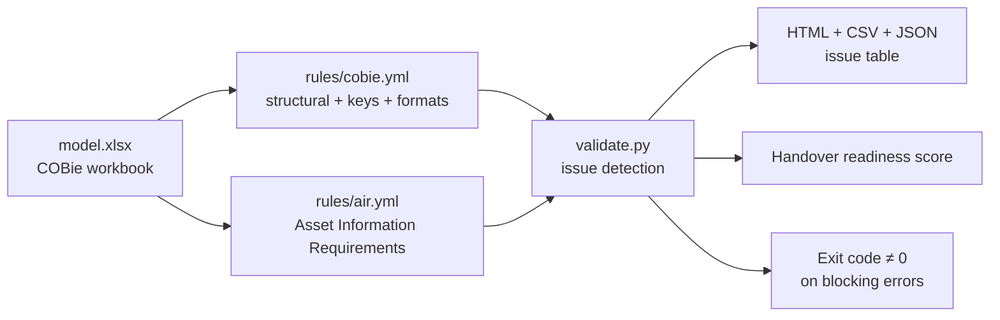

# P12: COBie validator and handover loader

> **Synthetic data for portfolio demonstration. No real building performance or compliance status is implied.**

## 1. Problem statement

COBie handover workbooks are critical for asset management, but are often inconsistent, incomplete and hard to load into CAFM. P12 validates a COBie workbook against structural, key, format and AIR rules, scores completeness, and produces a CI-usable gate.

## 2. Architecture



## 3. Data: sources, licences, synthetic note

- Valid and corrupted COBie workbooks generated by `make_sample_cobie.py`.
- Rules derived from buildingSMART COBie v2.4 and UK BIM Framework (see `docs/SOURCES.md`).
- No real COBie files committed; synthetic only.

## 4. Quick start (max 3 commands)

```bash
python projects/p12-cobie-validator/src/make_sample_cobie.py
python projects/p12-cobie-validator/src/cli.py validate data/cobie/valid.xlsx
python projects/p12-cobie-validator/src/cli.py validate data/cobie/corrupted.xlsx --out data/cobie/report_corrupted
```

## 5. Results (small synthetic workbook)

Valid workbook: score 100.0, 0 blocking, 0 warning.

Corrupted workbook: score ~70, 5 blocking, 2 warning. Detected categories: missing sheet (Zone), missing column (Contact.Email), empty mandatory (Facility.CreatedOn), duplicate key (Component.Name), broken FK (Component.TypeName), bad date format (InstallationDate), invalid category, missing manufacturer, duplicate serial.

## 6. Design decisions and trade-offs

- **Rules in YAML, not code** — structural, key, format and AIR rules are all declarative; adding a new check is a YAML edit.
- **Severity split** — blocking errors fail CI; warnings deduct from score but do not gate.
- **Score is weighted completeness** — 100 minus (blocking*10 + warning*2) clamped to zero; a workbook with missing mandatory sheets drops hard.
- **No loader yet** — this project focuses on validation; the handover loader (matching to `data/truth/assets.parquet`, quarantine, audit trail) is specified but not implemented in this commit.

## 7. Data quality and testing approach

- `tests/test_cobie.py` (8 tests): valid workbook zero blocking; corrupted finds missing sheet/column, duplicate key, broken FK, bad format, missing AIR attribute; score drops.
- Every seeded error category has a dedicated assertion.
- `ruff` clean on `src/` and `tests/`.

## 8. Limitations and next steps with real data

- Loader not implemented; valid COBie cannot yet be pushed into the asset register.
- Multi-value `Component → Space` cells are not parsed; FK rule treats the whole cell as one value.
- Category membership against Uniclass is not checked (P13 dependency).
- No incremental re-validation; every run reads the full workbook.

## 9. Skills demonstrated

E2 (rules-driven validation), E6 (issue taxonomy, scoring, CI gate), E7 (structured report + exit code), D3 (repeatable synthetic fixture), D6 (honest scope: validation only, loader is next).
