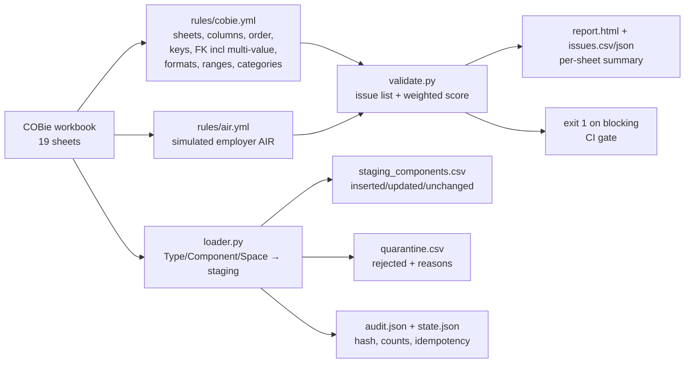

# P12: COBie validator and handover loader

> **Synthetic data for portfolio demonstration. No real building performance or compliance status is implied.**

## 1. Problem statement

A new building is only useful to Estates if its handover data lands cleanly in the
asset register. COBie workbooks arrive inconsistent — missing sheets, wrong columns,
duplicate assets, dangling references, gaps against the employer's Asset Information
Requirements — and loading them by hand is slow and unrepeatable. P12 turns handover
into a testable data process: validate the workbook against declarative rules, score
readiness, gate CI on blocking errors, then load clean rows into staging with
quarantine and an audit trail.

## 2. Architecture



## 3. Data: sources, licences, synthetic note

- Both workbooks are generated by `src/make_sample_cobie.py` for an anonymised
  campus building (B003 spaces). No real COBie files, no employer data.
- Sheet/column/key design follows buildingSMART COBie v2.4 and UK BIM Framework
  guidance — full provenance in `docs/SOURCES.md`; global register in `DATA.md`.
- `rules/air.yml` is a **simulated** employer AIR, not a statutory list.
- Category checks are syntactic patterns only; Uniclass membership waits for P13.

## 4. Quick start (max 3 commands)

```bash
python projects/p12-cobie-validator/src/make_sample_cobie.py
python projects/p12-cobie-validator/src/cli.py validate data/cobie/valid.xlsx --out data/cobie/report_valid
python projects/p12-cobie-validator/src/cli.py load data/cobie/valid.xlsx --out data/cobie/handover
```

Corrupted run + dry-run diff:

```bash
python projects/p12-cobie-validator/src/cli.py validate data/cobie/corrupted.xlsx --out data/cobie/report_corrupted
python projects/p12-cobie-validator/src/cli.py load data/cobie/corrupted.xlsx --out data/cobie/handover_bad --dry-run
```

Or `make p12-run` for validate + tests.

## 5. Results (synthetic workbooks, 2026-10-06)

- Valid workbook: **score 100.0, 0 blocking, 0 warning**.
- Corrupted workbook (42 seeded events): **score 39.0, 34 blocking + 20 warning**.
- Loader on valid: `inserted=8 rejected=0`; immediate re-run: `unchanged=8` (idempotent).
- Loader on corrupted: `inserted=3 rejected=6`, every reject reasoned in `quarantine.csv`.

Confusion matrix by seeded-error category (100% category recall — full table in
`docs/seeded_errors.md`):

| Seeded category | Events | Found by | Recall |
|---|---|---|---|
| missing_sheet | 2 | `sheet_*_present` | 2/2 |
| missing_column | 2 | `col_*` | 2/2 |
| column_order | 1 | `order_component_cols` | 1/1 |
| empty_mandatory | 6 | `mandatory_*` | 6/6 |
| duplicate_key | 3 | `unique_*_name` | 3/3 |
| broken_fk (single + multi-value + CreatedBy) | 9 | `fk_*`, `createdby_in_contact` | 9/9 |
| bad email/date formats | 4 | `format_*` | 4/4 |
| numeric_range | 4 | `range_*` | 4/4 |
| invalid_category | 3 | `category_*` | 3/3 |
| missing AIR attributes | 7 | `air_*` | 7/7 |
| duplicate_serial | 1 | `unique_component_serial` | 1/1 |

Score formula: `max(0, 100 − 1.5×blocking − 0.5×warning)`.

## 6. Design decisions and trade-offs

- **Rules in YAML, not code** — sheets, columns, order, keys, FKs (with
  `multi_value` splitting on `,;|`), formats, ranges, categories and the whole AIR
  live in `rules/`; adding a check is a YAML edit (proven by the AIR-edit test).
- **Blocking vs warning split** — structural/key/FK failures block CI;
  format/AIR gaps warn and only drag the score.
- **Score is a linear penalty, not a pass rate** — simple, reproducible, and honest
  about density: one bad email that cascades into CreatedBy failures costs more,
  which is documented rather than hidden.
- **Loader matches on serial first** — serial is the stable handover key; rows with
  missing/duplicate/unknown references go to quarantine with reasons instead of
  silently polluting staging. `space+type` is recorded as a fallback match note.
- **Idempotency via `state.json` row hashes** — file-based, no database needed for
  the portfolio; a DuckDB/DWH upsert is the production follow-up.

## 7. Data quality and testing approach

- `tests/test_cobie.py` (**17 tests**): valid zero-blocking; ≥40 seeded events;
  one test per rule family (sheets, columns, order, mandatory, unique incl. serial,
  FK incl. multi-value, CreatedBy, email/date formats, ranges, categories, AIR);
  AIR-edit-changes-results; loader insert/idempotent/dry-run/quarantine-reasons.
- Seeded-error log (`seeded_errors.json`) vs validator output cross-checked in
  `docs/seeded_errors.md`.
- `ruff check` + `ruff format --check` clean.

## 8. Limitations and next steps with real data

- Column order is enforced only for `Component` (first 9 columns); full per-sheet
  order matrices need the employer's COBie template.
- Loader staging is CSV + file state, not a DWH upsert; truth matching uses serials
  only (IFC GlobalId crosswalk is a P18 hook).
- Category check is syntactic; Uniclass membership needs P13 reference data.
- `Document`/`Attribute`/`Coordinate` sheets are validated structurally only.
- With real data: wire the validator into CI on handover drops, back the loader
  with a DuckDB/Postgres staging schema, and agree AIR thresholds with FM.

## 9. Skills demonstrated

E2 (rules-driven extraction/validation over a 19-sheet workbook), E6 (issue
taxonomy, weighted scoring, CI gate, FK/multi-value integrity), E7 (HTML/CSV/JSON
report, exit codes, quarantine + audit + idempotent loader), D3 (deterministic
synthetic fixtures with logged defects, recall matrix), D6 (provenance in
`docs/SOURCES.md`, simulated AIR labelled as such, cascades documented).
