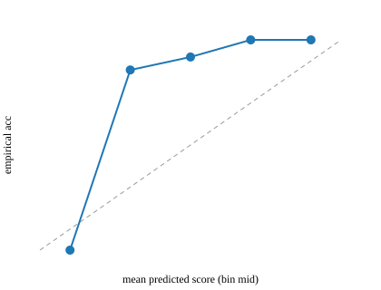

# P13: Uniclass classification mapper

> **Synthetic data for portfolio demonstration. No real building data is used and no
> classification here is an official Uniclass 2015 classification.**
> The official NBS tables could not be downloaded (login-gated), so the reference code
> list here is a clearly-labelled placeholder and every output carries `is_mock = true`.
> See [`docs/SOURCES.md`](docs/SOURCES.md) §1 — this is the single most important
> limitation of the project.

## 1. Problem statement

An estates asset register stores what a thing *is called*: "AHU-03 air hndlg unit L2",
"Boiler no 2 (Remeha)", "FCU fan coil rm 214". To join that register to space,
maintenance and carbon data — and to hand it over in a format clients can work with —
each asset needs a classification code (Uniclass 2015). Nobody can classify thousands of
messy free-text descriptions by hand, and nobody wants a model that guesses silently.
P13 assigns a code to every description, states how confident it is, explains *why* with
the terms that matched, and routes anything uncertain to a human whose corrections train
the next run.

## 2. Architecture

```mermaid
flowchart LR
    IN[CSV: asset_id, description] --> NORM[normaliser.py<br/>abbreviation expansion,<br/>stop-words, matching_query<br/>strips location/tag/manufacturer noise]
    NORM --> FUZ[fuzzy_matcher.py<br/>rapidfuzz token-set<br/>vs code titles]
    NORM --> EMB[embedder.py<br/>all-MiniLM-L6-v2<br/>cosine top-k vs titles]
    NORM --> KEY[keyword rules<br/>equipment-tag prefix,<br/>Products vs Systems]
    SYN[synonyms.csv<br/>curated + human overrides] --> KEY
    FUZ & EMB & KEY --> HYB[hybrid.py<br/>0.4 fuzzy + 0.4 embedding + 0.2 keyword<br/>+ bounded tag/synonym bonuses]
    HYB --> BAND[confidence band<br/>auto / review / reject<br/>thresholds from eval, dev split only]
    BAND --> OUT[classification_results<br/>chosen code, top-3 + scores,<br/>matched_terms, is_mock]
    OUT --> UI[review_ui.py (Streamlit)<br/>accept / override / note]
    UI --> DEC[human_decisions.csv]
    DEC --> SYN
    EVAL[eval.py<br/>fuzzy vs embedding vs hybrid,<br/>tune τ on dev, report on test] -.-> OUT
    REF[(uniclass_2015.csv<br/>official, is_mock=false)] --> REFLOAD[reference.py]
    PLACEHOLDER[(mock_uniclass_dev_placeholder.csv<br/>NON-AUTHORITATIVE)] -.-> REFLOAD
    REFLOAD --> FUZ
    REFLOAD --> EMB
    REFLOAD -.-> GUARD{--final?}
    GUARD -- "yes + mock" --> REFUSE[MockDataError<br/>writes nothing]
```

## 3. Data: sources, licences, synthetic note

| Input | What it is | Licence / status |
|---|---|---|
| Uniclass 2015 tables (Products `Pr_`, Systems `Ss_`) | The official NBS code list | **Not obtained** — https://uniclass.thenbs.com/download is login-gated. NBS terms of use not reviewed, so nothing is redistributed here |
| `data/mock_uniclass_dev_placeholder.csv` | 96-row placeholder written for this project (49 Products, 47 Systems) | Ours (synthetic). `is_mock=TRUE` on every row; **not** Uniclass codes |
| `data/golden_set.csv` | 1,324 labelled descriptions → codes | Synthetic, template-generated from hand-written examples |
| `data/review_sample.csv` | 265 rows (20.0%) sampled for human review | Synthetic; **human review not yet done** (0/265) |
| `data/synonyms.csv` | 52 curated phrases → codes | Curated for this project |
| `sentence-transformers/all-MiniLM-L6-v2` | Title embeddings | Apache-2.0, cached locally, not committed |

Descriptions imitate the *messiness* of a real CAFM register but were written for this
project; no employer register was copied. Provenance in
[`docs/SOURCES.md`](docs/SOURCES.md) and the portfolio [`DATA.md`](../../DATA.md).

## 4. Quick start

```bash
make p13-run                                       # fetch attempt + eval + tests
python projects/p13-uniclass-mapper/src/pipeline.py --input <your.csv> --output classified.csv
streamlit run projects/p13-uniclass-mapper/src/review_ui.py   # human review loop
```

`--final` is the switch that matters: with placeholder reference data it raises
`MockDataError` and writes nothing. First run downloads the embedding model
(~90 MB) into `data/reference/embeddings/`; after that the pipeline runs offline.

## 5. Results

Golden set 1,324 rows, split once and stratified by label: **train 909 / dev 187 /
test 228**. Thresholds tuned on dev only; test read once. Reproduce with
`make p13-eval` (seed 42) — output is `data/metrics.json`.

**Top-1 / top-3 accuracy**

| Method | train (909) | dev (187) | **test (228)** |
|---|---|---|---|
| Fuzzy baseline (rapidfuzz token-set) | 18.04% / 56.33% | 17.65% / 57.22% | **21.49% / 60.96%** |
| Embedding retrieval (MiniLM cosine top-k) | 57.43% / 80.64% | 56.68% / 81.82% | **57.02% / 81.14%** |
| Hybrid (fuzzy + embedding + keyword rules) | 98.46% / 99.78% | 98.40% / 98.93% | **97.81% / 99.56%** |

**Confidence policy (τ_high tuned on dev for ≥ 95% auto-accept precision)**

| | dev | test |
|---|---|---|
| auto-accept | 187/187 (100.0%) | 227/228 (99.56%) |
| auto-accept precision | **98.40%** (target ≥ 95%) ✔ | 98.24% |
| review / reject | 0 / 0 | 0 / 1 |

τ_high = 0.30, τ_low = 0.30 — see [`docs/error_analysis.md`](docs/error_analysis.md)
§2 for why an empty review band is a *result*, not a bug, and why the shipped defaults
(auto ≥ 0.85) are the policy I would actually run.

**Calibration** (test, 5 bins): 0.2–0.4 → 85.7% (n=7), 0.4–0.6 → 91.8% (n=49),
0.6–0.8 → 100% (n=64), 0.8–1.0 → 100% (n=108).



**All 5 test errors** are hierarchy errors, not taxonomy errors: 4 ×
`Pr_50_10_20 → Pr_50_10` (*"underfloor heating …"* takes the parent) and 1 ×
`Pr_50_40 → Pr_50_20_20` (*"dosing pot chemical"*, score 0.215). Raising τ_high to 0.60
gives a 100% auto-accept band at a 75.4% throughput cost — measured, and documented in
the error analysis.

**Review loop, measured end to end** (dev, empty synonym store): 78.61% top-1 →
reviewer overrides the 40 wrong rows → 98.93% top-1. Two rows resist even a synonym
override; both are written up in the error analysis rather than hidden.

## 6. Design decisions and trade-offs

| Decision | Alternative | Why this one |
|---|---|---|
| Weighted sum of fuzzy + embedding + keyword rules | Train a classifier (logistic regression / gradient boosting) over the same features | The rules are inspectable — every `matched_terms` entry (`word:pump`, `tag:prefix`, `syn:…`) can be shown to a reviewer, and an estates manager can argue with a rule in a way they cannot argue with a fitted coefficient. A learned reranker is the next step, not the first |
| `matching_query()` strips location, tag, manufacturer and numeric tokens before embedding | Feed the raw description | Raw text retrieved **Roofs** for *"LED panel light office"* and ducts for *"pressure sensor duct"* — location words dominate cosine similarity. The fix is in the query, not the model |
| Equipment-tag prefix boost (`AHU-03` → AHU family) as a bounded +0.15 | Regex rule that forces the code | A tag is strong evidence but not proof (*"BMS controller AHU-01"* is a controller serving an AHU); a bounded boost keeps it outroutable and reports the tag in `matched_terms` |
| Products-vs-Systems penalty (0.20) as a keyword sub-tree filter | Two separate models | Uniclass's Products/Systems split is an item-vs-system distinction, so the discriminator is lexical. Guarded by `test_golden_table_word_invariant`, which fails loudly if the golden set stops supporting the rule |
| Human overrides go to `synonyms.csv`, not to a retrained model | Re-fit the reranker on every decision | One reviewer action is one phrase; the store is reviewable in a spreadsheet and the effect is measurable (78.61% → 98.93% on dev). A retrained model would need its own review cycle |
| Bounded synonym bonus (0.25) | Unbounded, override always wins | Two dev rows stay wrong *because* of this choice. Bounded evidence beats a magic-word override that can flip a well-evidenced answer; the failure mode is visible in the review queue, which is where it belongs |
| numpy cosine retrieval, no FAISS | FAISS / scikit-learn | 96 codes. A brute-force cosine over 96×384 floats is instant, has no index to go stale, and drops two pinned dependencies. Swapping it in later touches one module |
| No LLM re-ranker implemented | Documented interface, off by default | The spec allows it optionally. An untested seam with no verifiable contract is dead code; §8 states exactly where it would attach |
| Reference data is a placeholder and the code refuses to pretend otherwise | Ship invented codes | AGENTS.md hard rule 4. `is_mock` propagates into every row, `--final` fails loudly, and `docs/SOURCES.md` records the failed download |

## 7. Data quality and testing approach

- **Validators and calculations are unit-tested first.** 21 tests, all passing
  (`python -m pytest projects/p13-uniclass-mapper/tests/ -q --no-cov`).
- **The normaliser has hand-checked fixtures**, not property tests: `"AHU-03 air hndlg
  unit L2"` → `"air handling unit air handling unit l2"`, `"Boiler no 2 (Remeha)"` →
  `"boiler number 2 remeha"`, `"FCU fan coil rm 214"` → `"fan coil unit fan coil room
  214"`. `matching_query` has its own fixtures (`"LED panel light office"` →
  `"led panel light"`, `"transformer 11kV/415V"` → `"transformer"`), because that is
  where the retrieval-relevant behaviour lives.
- **Hierarchy lookups** (`get_parent`, `get_children`, `get_subtree_codes`) are checked
  against the table, and the sub-tree filter is exercised by the confusion analysis.
- **Golden-set integrity tests**: ≥ 300 rows (1,324), review sample ≥ 20% (265 =
  20.02%), no blank descriptions, review sample still unsigned, and the
  Products/Systems word invariant the keyword rules depend on.
- **The round-trip test is the real acceptance test for the review loop**: it runs dev
  with an empty synonym store, records overrides through the same function the
  Streamlit UI calls, asserts the store contents and idempotency, and re-classifies. A
  second test drives the actual Streamlit app (`streamlit.testing.v1.AppTest`) through an
  Override submission and checks the files it wrote, against a scratch data directory.
- **The mock-data refusal is tested**, not just documented.
- Determinism: fixed seed throughout; `make p13-eval` reproduces `data/metrics.json`
  byte-for-byte (the only run-to-run variable is the embedding cache, which is
  content-addressed).
- `ruff check` and `ruff format --check` clean across the project.

## 8. Limitations and what I would do next

Ordered by how much they would change the numbers:

1. **Get the official tables, then re-label.** Everything above measures agreement with
   labels I wrote against a placeholder. A human with an NBS account must supply the
   Pr_/Ss_ tables, the golden-set labels must be re-checked against the real titles, and
   every number re-measured. Until then `is_mock = true` on every row is the only honest
   label.
2. **Complete the human review of `review_sample.csv`.** 265 rows are queued and 0 are
   reviewed; the spec requires ≥ 20% reviewed before accuracy is reported. My 265-row
   labels are exactly the thing that needs an independent check.
3. **A depth-aware score.** All four repeated errors are "stopped at the parent". A
   depth penalty when the description carries a leaf-specific discriminator would fix
   them; `Pr_50_10_20` is my guess at the mechanism, and it needs a real taxonomy.
4. **A learned reranker** over the same features (fuzzy, embedding, tag, synonym,
   depth) trained on the reviewed sample — with a calibrated probability instead of the
   hand-tuned weights, so τ_high stops being a judgement call.
5. **The LLM re-ranker seam** the spec asks for: an interface taking the top-10
   candidates plus description and returning a reranked list, off by default, reading
   its key from the environment. It belongs *after* the review set is trustworthy, and
   only as a tie-breaker between candidates that already score closely.
6. **Description ambiguity rules.** "humidity sensor AHU" is a sensor *inside* an air
   handling unit; no lexical rule can resolve that without a containment signal from
   the space/asset model (P11/P18 crosswalk).
7. **Threshold policy per source.** A handover import with 50 hand-typed descriptions
   deserves a stricter τ_high than a 50,000-row CAFM dump. Same scores, different
   bands — worth making a per-run decision rather than a constant.
8. **Other Uniclass tables.** Only Products and Systems are covered; the full 2015 set
   also has Activities (`Ac_`), Spaces (`Ss_` spatial), and more.

## 9. Skills demonstrated

| Criterion | Evidence |
|---|---|
| **E6** — standards and classification data quality | Official-table provenance and the refusal to invent codes (`docs/SOURCES.md`, `MockDataError`, `is_mock`); Products vs Systems sub-tree filtering |
| **D6** — measurable, reproducible ML-ish data work | Three-method comparison, dev-only threshold tuning, calibration, confusion analysis, error write-ups, seeded re-runs |
| Human-in-the-loop data operations | Streamlit review UI, `human_decisions`, active-learning loop measured at 78.61% → 98.93% on dev |
| Explainability | Every decision carries `matched_terms` (`word:`, `tag:`, `syn:`) and a top-3 candidate list with scores |
| Test-first validators | 21 tests; hand-checked normaliser fixtures; review round-trip and mock-refusal tests |
| Honest reporting | `is_mock` flags, the empty-review-band caveat, the two rows the loop cannot fix, and the 5 test errors listed individually |

**CV bullet:** *Built a Uniclass 2015 classification service for messy asset-register text:
three retrieval methods compared on a 1,324-row labelled set, confidence bands tuned on
a held-out dev split (98.4% auto-accept precision), and a human-review loop that lifted
dev accuracy from 78.6% to 98.9% — with the reference code list clearly flagged as a
placeholder until the official tables are licensed, rather than invented.*