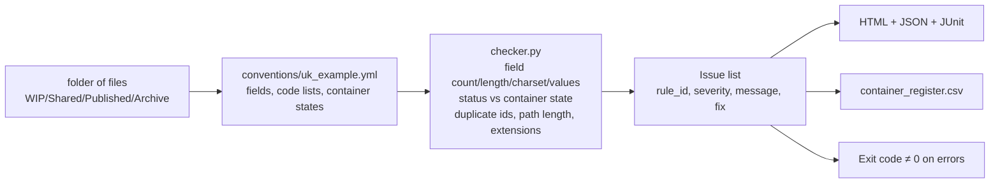

# P14: ISO 19650-style compliance checker

> **Synthetic data for portfolio demonstration. No real project or compliance status is implied.**

## 1. Problem statement

BIM projects produce hundreds of files that must follow a naming convention (ISO 19650 / UK BIM Framework style). Without a checker, files land in the wrong folders, with wrong statuses, wrong revisions, and no audit trail. P14 validates file/container naming and metadata against a configurable information-management convention, and gates CI on error-severity violations.

## 2. Architecture



## 3. Data: sources, licences, synthetic note

- Convention config in `conventions/uk_example.yml` — intentionally editable; verify field lengths/code lists against UK BIM Framework before production use (see `docs/SOURCES.md`).
- Sample folder generated by `make_sample.py` with seeded issues of every category.
- No real project files committed; synthetic only.

## 4. Quick start (max 3 commands)

```bash
python projects/p14-iso19650-checker/src/make_sample.py --out data/iso19650/sample --n 50
python projects/p14-iso19650-checker/src/cli.py check data/iso19650/sample --config projects/p14-iso19650-checker/conventions/uk_example.yml
python projects/p14-iso19650-checker/src/cli.py check data/iso19650/sample --format junit --out data/iso19650/report
```

## 5. Results (small synthetic sample, 50 files, seed 42)

- 15 seeded issues across 8 categories.
- Checker compliance: 52.0% (43 errors in 50 files). Error breakdown matches seeded categories: disallowed extensions (.exe), field count/missing fields, field length (TOOLONG revisions), charset violations (lowercase fields), status-container mismatch, duplicate identifiers, path length warnings.
- JUnit XML and JSON outputs verified.

## 6. Design decisions and trade-offs

- **Everything from config** — fields, lengths, charsets, allowed values, container-state mapping, separator, extension allowlist, path max length. Swapping the YAML changes behaviour with zero code edits (tested).
- **No metadata extraction** — this version checks filename structure only. IFC/docx/pdf title extraction is a stretch goal and would require optional dependencies.
- **No `--apply` yet** — suggest mode is declared; apply/rename with rollback is a stretch.
- **Status length is nullable** — WIP is 3 chars, S1/S4/S7 are 2; the config allows variable length for that field while still enforcing allowed values.

## 7. Data quality and testing approach

- `tests/test_checker.py` (2 tests): all seeded issue categories detected; config swap produces different results with no code change.
- `ruff` clean on `src/` and `tests/`.
- Sample generator is deterministic (seed 42) so tests are reproducible.

## 8. Limitations and next steps with real data

- No `--apply`/rollback implementation yet (stretch).
- No metadata consistency check (filename vs document title) — requires optional deps.
- No pre-commit hook or GitHub Action committed yet (stretch).
- Convention details must be verified against official UK BIM Framework guidance before production use.

## 9. Skills demonstrated

E6 (rules-driven validation), E7 (CI-usable gate, JUnit output), D6 (honest scope: structure only, no metadata extraction yet).
