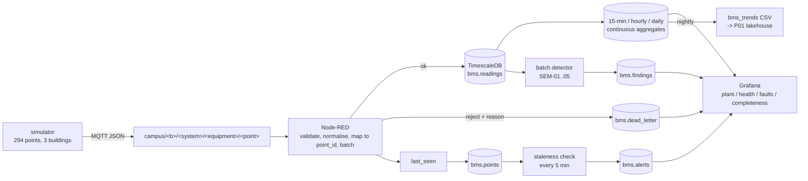

# P15: BMS and sensor ingestion

> **All data in this project is synthetic.** It comes from
> [`src/simulator.py`](src/simulator.py). Nothing here describes a real
> building, a real controller, or the real performance of any plant. Where a
> dashboard shows a fault, that fault was injected deliberately and is listed
> in [`docs/fault_detection.csv`](docs/fault_detection.csv).

## The problem, in plain English

Estate teams get their building management system data as a firehose of
readings they cannot check: a valve that stopped moving looks exactly like a
valve that is simply closed, and a sensor that has drifted for six weeks looks
exactly like one reporting correctly. The dashboard is green either way. So the
plant engineer either visits every AHU on a schedule, or finds out in February
that a heating valve has been stuck at 62% since August.

This project builds the ingestion layer that makes that visible: readings arrive
over MQTT, get checked against a written contract, land in a time-series store
with continuous aggregates, and are then read by both a streaming staleness
check and a batch fault detector. The detector's output is what an engineer
sees on shift: *this valve has not moved in an hour while its paired valve has*,
with the evidence attached.

The decision it supports: which plant items get an engineer this week, and
which wait.

## Architecture

Full detail, including why each component is here, in
[`docs/architecture.md`](docs/architecture.md).



## Data

| what | source | licence / provenance |
|---|---|---|
| BMS telemetry | generated by `src/simulator.py` (synthetic) | n/a - no external data |
| point registry | generated by `src/make_registry.py` | n/a |
| validation ranges and units | written by hand in `contracts/validation_rules.json` | n/a - engineering judgement, not a standard |
| `data/raw/bms_trends_*.csv` | this project's export | n/a |

No real site data, no vendor dataset, no scraped protocol documentation. The
plausible ranges in the contract are engineering judgement about what a supply
air temperature *can* be, and they are labelled as such in
`[topic-taxonomy.md](docs/topic-taxonomy.md)` rather than presented as a
standard. `DATA.md` has the full entry.

## Quick start

The whole thing runs without Docker:

```bash
make iot-test       # 237 tests, ~2 min
make iot-offline    # simulate 24 h, validate, detect faults, export for P01
```

For the live stack (needs Docker Desktop):

```bash
cp projects/p15-bms-iot/.env.example projects/p15-bms-iot/.env   # change the DEMO values
make iot-up        # mosquitto + timescaledb + nodered + grafana
make iot-demo      # publish 24 simulated hours at 144x, then load the dashboards
```

Then open <http://localhost:3000> (Grafana) or <http://localhost:1880>
(Node-RED). Credentials are in `projects/p15-bms-iot/.env`.

## Results

Measured on this repository's code, seed 42, 24 simulated hours at a 5-minute
cadence. Reproduce with `make iot-offline`; the pinned numbers are in
[`tests/test_pipeline.py`](tests/test_pipeline.py) and
[`docs/ACCEPTANCE_P15.md`](docs/ACCEPTANCE_P15.md).

### Ingestion

| measure | value |
|---|---|
| points in the registry | 294 (24 plant items + 51 rooms, 3 buildings) |
| messages simulated | 84,576 |
| dropped by the injected comms dropout | 96 |
| malformed payloads injected | 141 |
| **valid messages** | **84,435** |
| accepted into `bms.readings` | 84,435 |
| **ingestion rate of valid messages** | **100.0000%** (spec asks >= 99.9%) |
| dead-lettered | 141, all `MISSING_FIELD` |

The malformed payloads are sent with the `quality` field omitted, so the
`MISSING_FIELD` path is exercised end to end rather than only in a unit test.

### Fault detection

Five fault modes, four windows each, 20 planted windows in total.

| fault | rule | planted | detected | recall | mean detection delay |
|---|---|---|---|---|---|
| simultaneous heating + cooling | SEM-01 | 4 | 4 | 100% | 0 min |
| stuck valve | SEM-02 | 4 | 4 | 100% | 0 min |
| out-of-hours plant operation | SEM-03 | 4 | 4 | 100% | 0 min |
| sensor drift | SEM-05 | 4 | 4 | 100% | 120 min |
| comms dropout | STALENESS | 4 | 4 | 100% | -5 min |
| **total** | | **20** | **20** | **100%** | |

Two numbers in that table deserve explanation rather than celebration:

* **SEM-05's 120-minute delay is the rule's window, not slowness.** Drift is
  only distinguishable from normal control movement over six hours, so the
  detector cannot fire earlier than that. The delay is the honest cost of not
  alerting on every healthy valve ramp.
* **STALENESS's -5 minutes is correct.** A staleness finding is timestamped at
  the last sample *received*, which is by definition before the gap that
  revealed it. A negative delay here means the alert fires on the first missed
  interval, not that detection was early.

### False positives

The number that matters more than recall. Same 24 hours, same seed, no faults
injected:

| measure | faulty run | clean run |
|---|---|---|
| findings | 20 | **0** |
| unhealthy points | 4 of 294 | **0** |
| lowest completeness | 99.31% | 98.96% |

Completeness is not 100% in either run because malformed payloads are
dead-lettered rather than stored, which is the correct behaviour: the two or
three missing samples per point are the injected defects.

A detector with 100% recall and no false positives is a claim, not a
measurement, so both halves are pinned as tests: one asserts every planted
window is found, the other asserts a clean plant produces nothing.

### The fault detection table

Every injected fault, its rule, and where an engineer would see it:

| fault | rule id | how it is detected | where it appears |
|---|---|---|---|
| simultaneous heating and cooling | SEM-01 | heating and cooling valve both > 20% on the same equipment within one 5-minute step | Plant Overview "Heating and cooling valve positions"; Active Faults findings table |
| stuck valve | SEM-02 | valve position constant for >= 30 samples while its paired valve moves > 1% | Plant Overview (flat line against a moving peer); findings detail |
| out-of-hours operation | SEM-03 | `fan_speed` > 20% outside 07:00-19:00 weekdays (09:00-17:00 weekends) | Plant Overview "Fan speed and damper position"; Active Faults |
| flat-line sensor | SEM-04 | no value change for >= 60 samples (5 h at this cadence) | Point Health completeness table |
| sensor drift | SEM-05 | \|Spearman rho\| >= 0.98 over a 6-hour window, range >= 25 units, no reversal > 10 units | Active Faults findings table |
| comms dropout | STALENESS | gap > 3 sampling intervals, or `last_seen` > 10 minutes old | Point Health "Points not healthy"; `bms.alerts` |
| malformed payload | (not a fault) | missing required field | Active Faults "Dead letter by reason" |

### Screenshots

Not included: this was built in an environment without Docker Desktop, so the
Grafana stack could not be started and no screenshots exist. The dashboards are
provisioned from committed JSON (`make iot-dashboards`) and their SQL is
asserted against the schema by tests, but "the dashboard renders" is not
something this repository can show you. See
[`docs/ACCEPTANCE_P15.md`](docs/ACCEPTANCE_P15.md) for the exact list of what
was and was not verified.

## Design decisions and trade-offs

### The topic taxonomy carries the equipment segment

The spec asked for `campus/<building>/<system>/<point>`. That shape is not
unique: `campus/B001/ahu/cooling_valve` is the topic for three AHUs, so the
topic-to-`point_id` lookup in Node-RED sent every one of them to the same
place. 294 points collapsed onto 45 topics and two thirds of the plant data
vanished with no error anywhere.

The fix is `campus/<building>/<system>/<equipment>/<point_class>`, and a test
that fails if topics are ever non-unique again. The cost is one more topic
level; the benefit is that the pipeline can actually tell one AHU from
another.

### The contract lives in JSON, and both runtimes read it

`contracts/validation_rules.json` holds the required fields, the unit per point
class, the plausible ranges and the timestamp budget. The Python validator
compiles the pattern directly; the Node-RED function node reads the same file at
runtime through a global set by the registry-seed tab. Neither side hard-codes a
threshold.

Three tests hold that together: the Python and JSON tables must match, the
flow's JavaScript regex must be the contract's regex with JS group syntax, and
the reason codes the flow can emit must be exactly the documented set. The
failure this prevents is the expensive one - tests passing while production
rejects different messages.

### Drift and flat-line are separate rules

An early version had one rule for both, and it produced 52 findings where there
were 4 faults. A healthy control signal also moves monotonically: a valve
opening towards setpoint ramps, holds, then settles. Monotonicity alone is not
drift.

Splitting them and requiring a drift to persist across a six-hour window with
no reversal inside it took the finding count from 67 to 20 on the same data. It
is also the difference between a useful alert and one an engineer learns to
ignore. A stuck valve is an equipment fault worth visiting; a drifting sensor
needs recalibrating; a flat-line needs neither interpretation. Three rules,
three actions.

### Simultaneous plant faults are planted on disjoint equipment

The simulator's first plan put a stuck heating valve and a simultaneous
heating/cooling fault on the same AHU, in overlapping windows. SEM-01 then fired
two hours before the planted heat/cool fault, because a valve frozen at 62%
already looks like an open heating valve next to an open cooling one. Recall was
100% and every number was meaningless.

Now the two faults use different AHUs, their windows do not overlap on the same
point class, and the run starts at local midnight so the window comments name
real clock times. Two tests enforce it.

### Faults must stay inside the contract's ranges

The drift fault ramps CO2 by 8 ppm per sample. Over its original window that
peaked above the 10,000 ppm contract ceiling, so the readings were dead-lettered
as out of range and the fault would have been scored as a data-quality failure
rather than a detection. Fault injection has to respect the validation
contract, or the two are indistinguishable.

### Batch detection, not just streaming

Staleness is a streaming question and belongs in the flow: within minutes, no
human involved. Stuck valves and drifting sensors are not; they need hours of
history, so they are a batch job over `bms.readings` writing to `bms.findings`.
Trying to do both in Node-RED function nodes would have produced a flow nobody
could test.

### Export matches the contract P01 already validates

The spec said Parquet; P01 validates a wide CSV (`platform/contracts/bms_trends.yml`)
with ISO timestamps carrying an offset, units in the header and `N/A` for
missing cells. The export matches P01's existing contract rather than changing
P01. A test asserts the committed generated SQL still covers every registry
point, because a stale export silently drops every point added since.

### Offline path first, live path second

`make iot-offline` runs the whole chain - simulate, validate, detect, export -
with no broker and no database. It is what CI runs and what produced every
number in this README. The live path adds MQTT, Node-RED and Grafana on top and
runs the *same* validator and detector.

The reason is not convenience: a demo that only works when five containers are
healthy cannot be used to check whether a detection rule still works.

## Data quality and testing

237 tests, 95% line coverage over `src/`.

| area | what is asserted | why it matters |
|---|---|---|
| registry | topic uniqueness, 1:1 with `point_id`, agreement with the contract, the committed CSV matching the generator | a dropped point or a duplicate topic is silent data loss |
| simulator | values inside the contract's ranges, determinism per seed, every fault window does what the truth file says | otherwise the detector is being tested against an unfair dataset |
| validation contract | each of the 11 rejection reasons is reachable, units normalise, Fahrenheit converts, hostile input never raises | dead-letter reasons are only useful if each one means what the README says |
| contract sync | Python rules == JSON rules == the flow's JS pattern and reason codes | the failure this prevents is tests passing while production behaves differently |
| health rules | one hand-built series per fault, expected finding stated in the test | a detector tested only against itself proves nothing |
| schema | every statement re-runnable, all policy calls idempotent-guarded, the daily aggregate sums energy and the others do not | `make iot-up` re-runs the migration; a non-idempotent statement fails a restart |
| Grafana | committed dashboards match the generator, every query hits an object `schema.sql` creates | a dashboard querying a missing table renders empty, with no error |
| export | filename pattern, offset timestamps, `N/A` cells, local-time date in the filename | a mismatched file is quarantined by P01, not rejected loudly here |
| pipeline | every planted fault detected **and** a clean plant producing zero findings | recall alone is half a metric |

Anything that computes a number - the drift rule, the reversal measure, the
completeness calculation, the staleness budget - has a hand-checked fixture.

## Limitations, and what I would do next

Honest list:

1. **The live stack has not been run.** Docker Desktop was not available in the
   build environment, so `make iot-up` and `make iot-demo` are unverified, and
   there are no Grafana screenshots. Everything that does not need a broker or
   a database is tested; the Node-RED flow is verified structurally (its JSON,
   its wiring, its rule parity with Python) but has not been executed.
2. **Detection metrics are measured against injected faults only.** 100% recall
   on five synthetic fault types says the rules work on those five. It says
   nothing about a fault mode nobody thought of, and real drift does not ramp at
   a constant 8 ppm per sample.
3. **No false-positive measurement on real data.** The clean-run figure is
   zero findings on synthetic healthy plant. Real healthy plant is noisier.
4. **No BACnet or Modbus publisher.** The mapping to those protocols is
   documented in detail, and the topic abstraction is the part that matters for
   the data contract, but nothing here speaks either protocol.
5. **Retention and compression settings are guesses.** 7-day compression and
   400-day raw retention are starting points for sizing, not a policy agreed
   with anyone.
6. **TimescaleDB-specific.** The schema uses hypertables, compression policies
   and continuous aggregates. Porting the storage layer to plain Postgres means
   rewriting the aggregate maintenance.
7. **`bms.findings` is written by a batch job, not the flow.** Fine for a demo;
   a production design would decide whether detection belongs in a stream
   processor or a scheduled job, and that is a real architectural choice, not a
   detail.

Next, in order: run the live stack and put screenshots in `docs/img/`; add a
Modbus register map fixture so the gateway's word-swap problem is tested rather
than described; add a fault mode nobody would think of on their own (a slowly
intermittent sensor is the obvious candidate) to find out how the recall holds
up; and measure the rules against a month of real plant data once there is any.

## Skills demonstrated

| criterion | evidence |
|---|---|
| **E2** - integrate data from building systems | MQTT ingestion, Node-RED flow, TimescaleDB schema with hypertables and continuous aggregates |
| **E4** - data quality / validation | 11-reason validation contract, dead-letter queue, unit normalisation, staleness monitoring, 237 tests |
| **D2** - low-code / flow tooling | the Node-RED flow is the production ingest path; rules-as-data shared with the Python reference |
| **D3** - monitoring and observability | four provisioned Grafana dashboards, `bms.alerts` with a staleness check, per-point health, completeness heatmap |
| **D7** - documentation and reproducibility | generated registries, flows, dashboards and SQL with drift tests; fault-detection table; pinned seeds |

## Repository layout

```
p15-bms-iot/
  README.md  SPEC.md  pyproject.toml
  contracts/validation_rules.json   # the ingestion contract, read by both runtimes
  src/
    simulator.py       # seeded BMS telemetry generator with fault injection
    validate.py        # the contract as executable code (Python reference)
    ingest_contract.py # applies the contract to a messages frame
    health.py          # point health + SEM-01..05 detector
    make_registry.py   # generates src/point_registry.csv
    run_pipeline.py    # offline end-to-end chain
    export_bms_trends.py / export_sql.py   # the P01 lakehouse file
    load_db.py         # Parquet outputs -> TimescaleDB
    grafana_dashboards.py  # generates the four dashboards
    schema.sql         # migration, safe to re-apply
  flows/               # Node-RED flow fragments + the merged p15_bms.json
  grafana/provisioning/# datasource and the four dashboards
  sql/                 # generated nightly export SQL
  tests/               # 237 tests
  docs/                # architecture, taxonomy, naming, real-system mapping, acceptance
  docker-compose.yml  mosquitto.conf  Dockerfile.nodered
```