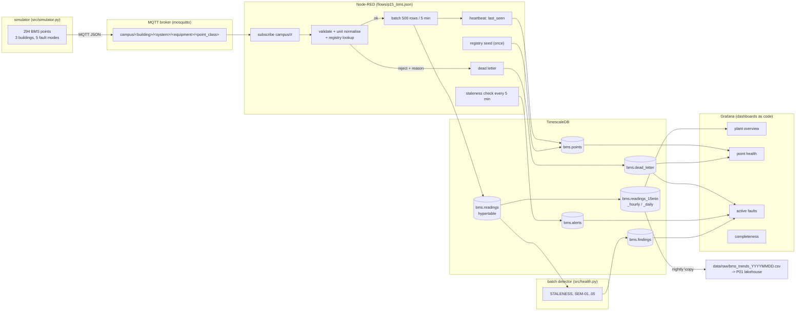

# P15 architecture

## The pipeline in one picture

Everything in this diagram is **synthetic**. The simulator is the source of
every number; no real building, controller or meter is involved. See
[`mapping-to-real-systems.md`](mapping-to-real-systems.md) for how each
component would be replaced in a live deployment.

## Why these components

**MQTT between the simulator and the ingest logic, not a shared database.**
A real BMS talks to collectors over a network protocol with its own failure
modes, so the demo uses one. Publishing decouples the producer from the
consumer: the simulator does not know whether validation, batching or the
database is healthy, which is exactly the property that matters when a
controller is the thing being replaced.

**Node-RED as the ingest logic, not Python.** The pipeline stages the spec asks
for (subscribe, validate, normalise, map to `point_id`, batch insert, dead
letter, heartbeat, staleness alert) are the kind of wiring a controls engineer
wires and an estates analyst has to be able to read. Keeping it in a flow
rather than a script means the operational logic is inspectable in a browser.
The Python in `src/validate.py` and `src/health.py` exists to make those rules
*testable*: the validator is the executable specification, and the flow reads
its thresholds from `contracts/validation_rules.json` at runtime, so the two
cannot drift without a test failing.

**TimescaleDB rather than plain Postgres.** Readings arrive on a fixed cadence,
so the natural access pattern is "every point, every 5 minutes". Hypertables,
compression keyed on `point_id` and three continuous aggregates turn that into a
cheap query instead of a full scan. The aggregates are what the dashboards read
and what the nightly export copies, so the raw table can be compressed and
aged out without losing the daily energy history.

**A batch detector alongside the streaming staleness alert.** Two different
questions. "Has this point gone quiet?" is answerable within minutes and must
be automatic (`STALENESS` in the flow). "Is this valve stuck, or is this CO2
sensor drifting?" needs hours of history, so it is a batch job over
`bms.readings`, and its output is written back to `bms.findings` for the
dashboards.

## Data flow, step by step

1. `make iot-demo` runs the simulator, which publishes one JSON message per
   point per interval: `{ts, value, unit, quality}` on
   `campus/<building>/<system>/<equipment>/<point_class>`.
2. Node-RED subscribes to `campus/#` and runs `fn_parse`: topic pattern,
   required fields, quality enum, numeric value, timestamp sanity, per-class
   unit and range, then a registry lookup for `point_id`.
3. Accepted rows are batched (500 rows or 5 minutes) and upserted into
   `bms.readings`. The upsert is on `(ts, point_id)`, so at-least-once delivery
   does not duplicate rows.
4. Rejected rows go to `bms.dead_letter` with a reason code and the original
   payload.
5. Each flushed batch also upserts `last_seen` into `bms.points`.
6. Every 5 minutes, a staleness check inserts a `bms.alerts` row for any point
   whose `last_seen` is more than 10 minutes old. A partial unique index keeps
   one open row per point and alert type.
7. `bms.readings_hourly` and `bms.readings_daily` are maintained by continuous
   aggregate policies; `make iot-export` (or `sql/export_bms_trends.sql` in the
   container) writes the wide `bms_trends` CSV for P01.

## The two run modes

| | offline | live |
|---|---|---|
| command | `make iot-offline` | `make iot-up && make iot-demo` |
| needs Docker | no | yes |
| what runs | `run_pipeline.py` end to end | simulator -> MQTT -> Node-RED -> TimescaleDB, then the offline chain for the batch findings |
| use | CI, tests, reproducing numbers | seeing data in Grafana |

The offline path exists because it is the one that can run in CI and produce
the numbers the README quotes. It executes the same validator and the same
detector as the live path; the only difference is Parquet in place of the broker
and the database.