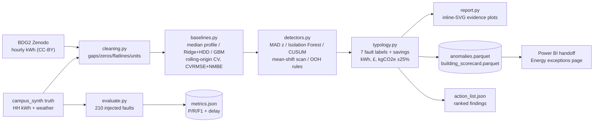

# P16 — Energy anomaly and fault detection

> **Synthetic-data notice.** Every campus meter, reading, weather value and
> "planted fault" in this project is generated by `campus_synth`. No result here
> describes the performance of a real building, and no number here should be
> quoted as a real energy saving. The BDG2 section uses genuinely public meter
> data (Zenodo, CC-BY 4.0) but there are **no labels for it, so no accuracy is
> claimed** — it is a review queue, not a benchmark.

## 1. The problem, in plain English

An estates team sees a bill, or a BMS dashboard, and a number goes up. The
question they cannot answer is *which building, which fault, and what is it
worth fixing first?* Meter data arrives as a wall of half-hourly kWh with no
labels, and 90% of it is unremarkable. This project builds the triage layer: for
every meter, fit what "normal" looks like, then list the meters that deviate in
a way a caretaker could act on, ranked by estimated annual value, each with a
plot that shows the evidence.

It answers three questions a dashboard alone cannot:

1. **Which meters are anomalous, and in what way?** (overnight baseload, a
   step change, a slow drift, spikes, a stuck meter, missing data)
2. **How confident can we be?** Precision/recall against known injected faults
   on synthetic data, honestly reported including the weak numbers.
3. **What is it worth?** kWh, £ and kgCO₂e per year, with the assumptions and an
   uncertainty band stated, attributed only to faults that were actually flagged.

## 2. Architecture



## 3. Data

| Source | Licence | Use |
|---|---|---|
| `campus_synth` synthetic campus (default + small profiles) | generated, not a real campus | planted faults B007 / B019 / M-B015 with known ground truth |
| **Building Data Genome Project 2**, Zenodo DOI `10.5281/zenodo.3887306`, 595 MB zip, md5 `44393dc4cf61e84dec105e955368c890` | CC-BY 4.0 | 50 education buildings (Rat, US/Eastern; Lamb, Europe/London), hourly 2016–17, review queue only |
| DESNZ 2025 GHG conversion factors (via the P04 seed) | OGL v3.0 | electricity 0.177, gas 0.2027 kgCO₂e/kWh |

BDG2 is fetched by script and cached under `data/p16_bdg2/` (gitignored, never
committed). Timestamps are site-local naive in the release; they are localised
with the metadata timezone and converted to UTC, with ambiguous hours dropped
rather than fabricated. Full provenance: root `DATA.md`, and
`docs/methodology.md`.

## 4. Quick start

```bash
pip install -e "projects/p16-energy-anomaly[dev]"   # or: make -C projects/p16-energy-anomaly setup
make -C projects/p16-energy-anomaly eval            # injection study + campus action list (~2 min)
make -C projects/p16-energy-anomaly test            # 36 unit tests (~30 s)
make p16-run                                       # tests + eval + threshold-transfer check
```

Run from the repo root. Without `make` (e.g. stock Windows), the same three steps:

```powershell
pip install -e "projects/p16-energy-anomaly[dev]"
$env:PYTHONPATH="projects/p16-energy-anomaly/src"; python -m anomaly.cli evaluate --out projects/p16-energy-anomaly/outputs
python -m pytest projects/p16-energy-anomaly -q -p no:cacheprovider --no-cov
python projects/p16-energy-anomaly/scripts/threshold_separation.py
```

Optional, for the public-data review queue (needs ~1.2 GB free for the zip):

```bash
make -C projects/p16-energy-anomaly data            # download + md5 + extract subset
PYTHONPATH=projects/p16-energy-anomaly/src python -m anomaly.cli review-bdg2
```

## 5. Results

All numbers below are copied from `outputs/metrics.json`, regenerated by
`make eval` from seed 7 on the default profile. Re-running reproduces them
exactly (fixed seeds, deterministic baselines).

> **Read this first.** One detector threshold does not survive testing on both
> campus profiles: the overnight-baseload rule has 0 false positives on the
> small profile and **21 of 58** on the default profile. That is measured, not
> estimated — `python scripts/threshold_separation.py` reproduces it. The action
> list below still ranks the planted faults correctly because it is dominated by
> the small profile, but on a full campus this rule would flood the list. Full
> write-up in `docs/methodology.md` §3.1, limitations in §8.

### 5.1 Injection study — 210 labelled faults on held-out meter M-B001-E01

35 events per type (step, drift, spike, flatline, ooh, missing), sparse and
non-overlapping, injected after a clean 90-day training window. Delay is the
first flag offset in periods after onset; `-1` means never detected.

| Method | spike | drift | step | ooh | flatline | missing |
|---|---|---|---|---|---|---|
| MAD z-score | **P 1.00 / R 0.74 / F1 0.85**, delay 0.0 | P 0.63 / R 0.14 / F1 0.23, delay 36.8 | not detected | P 0.25 / R 0.03 / F1 0.05, delay 27.0 | n/a (by design) | n/a (by design) |
| Isolation Forest | P 0.65 / R 0.86 / F1 0.74, delay 1.2 | P 0.48 / R 0.40 / F1 0.44, delay 29.4 | P 0.17 / R 0.11 / F1 0.14, delay 43.5 | P 0.39 / R 0.26 / F1 0.31, delay 5.9 | P 0.05 / R 0.03 / F1 0.04, delay 31.0 | P 0.05 / R 0.03 / F1 0.04, delay 49.0 |
| CUSUM | P 0.05 / R 1.00 / F1 0.09, delay 0.0 | P 0.04 / R 1.00 / F1 0.09, delay 1.2 | P 0.04 / R 1.00 / F1 0.09, delay 0.1 | P 0.04 / R 1.00 / F1 0.09, delay 0.1 | P 0.04 / R 1.00 / F1 0.08, delay 0.4 | P 0.03 / R 0.71 / F1 0.06, delay 41.8 |
| flat-line rule | — | — | — | — | P 0.50 / R 0.46 / F1 0.48, delay 44.0 | — |
| missing rule | — | — | — | — | — | P 1.00 / R 1.00 / F1 1.00, delay 0.0 |

Read this honestly, it is the most interesting part of the project:

- **Spikes are easy.** MAD z-score is the best spike detector (F1 0.85, zero
  delay); Isolation Forest finds more (recall 0.86) at the cost of precision.
- **CUSUM is a net, not a needle.** Recall 1.0 everywhere with precision ~0.04:
  after any sustained shift the accumulator stays tripped, so it flags far more
  periods than events. That is expected behaviour for CUSUM and is why it ranks
  *findings*, not periods — it is what identifies "this meter changed and stayed
  changed", not "this period is odd".
- **Steps are hard.** Best recall is 0.11–0.14 for MAD/IF; only the mean-shift
  change-point scan and the overnight-creep test localise them reliably (used in
  the typology, not scored in this table). A ±1σ step is close to the noise
  floor of a 30% CVRMSE baseline.
- **The dedicated rules are exactly as good as they should be.** Flat-line
  recall 0.46 with delay 44 periods is the window length showing up: the rule
  needs 48 identical readings before it fires. Missing-data recall 1.00.
- **Recall 1.0 with precision 0.0 is an artefact I chose to avoid**: a dense
  pilot (220 events on 1,440 periods) saturated the robust scale estimators and
  produced recall-1/precision-0 scores. Sparse, non-overlapping injection is the
  honest design; documented in `docs/methodology.md` §5.

### 5.2 Planted campus findings

Both planted faults that the spec asks for are in the top 3 of the ranked action
list, with savings, in the right order:

| Rank | Meter | Source | Fault types found | £/yr | kWh/yr |
|---|---|---|---|---|---|
| 1 | M-B007-E01 | small profile | `gradual_drift`, `high_overnight_baseload`, `step_change` | £7,817.23 | 27,918.7 |
| 2 | M-B019-G01 | default-profile cache | `spike`, `step_change` | £815.37 | 2,912.0 |
| 3 | M-B008-E01 | small profile | `spike` | £87.03 | 310.8 |

M-B015-E01's planted 5-day flat-line is detected with 193 of 240 flaggable
periods (the first 48 are the rule's warm-up window by construction), and the
change-point scan brackets the B019 fault at 2025-07-06 / 2025-08-10 against a
planted 07-07 → 08-10. Full per-building evidence pages:
`outputs/reports/B007.html`, `outputs/reports/B019.html`,
`outputs/reports/B015.html`.

### 5.3 BDG2 (public data, no labels, no accuracy claimed)

50 education buildings ranked by flag count; the top 6 get an evidence page in
`outputs/bdg2/` plus `outputs/bdg2/review.json`. Costs are shown in USD at an
illustrative $0.15/kWh and **no CO₂ is reported**, because UK DESNZ grid
factors do not apply to US or Irish grids. These are candidates for a human to
check, not findings.

### 5.4 Baseline fit quality

Rolling-origin CV (expanding train window, 7-day test chunks) with CVRMSE and
NMBE per baseline is recorded per meter in the scorecard; GBM and regression are
within noise of each other on these series, and the regression is used for
detection residuals because it fits in milliseconds and is transparent enough to
explain to an estates team. See `docs/methodology.md` §2.

Screenshots for Power BI go in `docs/img/` (empty by design — see the handoff
protocol; `powerbi/` has everything needed to build the page).

## 6. Design decisions and trade-offs

- **No `ruptures`, no plotly/matplotlib.** Change points come from a two-sided
  CUSUM plus a sliding-window mean-shift scan (both unit-tested on series with
  known answers), and evidence plots are dependency-free inline SVG. One less
  heavy install, renders anywhere. Documented deviation from the spec stack.
- **Overnight-drift test on night means, not residuals.** A baseline trained on
  month 1 develops seasonal bias by month 3–24; a residual first-vs-last test
  flags *every* meter for drift. Nights are occupancy-free, so a rising night
  mean is a rising baseload by construction.
- **Thresholds measured, not invented — and one of them failed under test.** The
  overnight threshold (50% of the 99th-percentile peak) separates cleanly on the
  small profile (normal max 0.463 vs planted 0.553: 1 TP, 0 FP) but **does not
  separate on the default profile**: 21 of 58 normal electricity meters sit at
  0.52–0.55 and produce false positives, while the planted fault measures only
  0.530 because the fault starts 9 months into the series. The overnight-drift
  threshold (8% of peak) does transfer: 0 FP on both profiles. Reproduce with
  `scripts/threshold_separation.py`; the failure and the known fix (compare each
  meter against its own baseload or its building type's percentile rather than a
  global fraction of peak) are written up in `docs/methodology.md` §3.1.
- **Savings attributed only to flagged fault modes.** Normal baseload is an
  efficiency opportunity, not an exception, so it carries no savings here. A
  stuck or gappy meter cannot have its use estimated: £0 and a data-quality
  flag. Gas meters take baseline deviation only — night gas in the heating
  season is legitimate heating, not waste.
- **Electricity-only waste rules.** Same reason, applied to labels: weekend and
  overnight *gas* patterns are not exceptions.
- **Weather gaps imputed to 0 heating-degree-hours**, which reads as "mild day".
  Stated in `baselines.design_matrix`, not hidden: a cold period with missing
  weather shows up as a positive residual and can be flagged.

## 7. Data quality and testing

36 unit tests, ~30 s, no network or `data/` dependency:

- per-detector known-answer fixtures (pure step change at a known timestamp,
  overnight creep, perfect-detection scoring, deterministic injection);
- cleaning arithmetic (null/negative/zero counts) and savings maths;
- loader behaviour including DST: ambiguous local hours are dropped,
  nonexistent hours are shifted forward, never fabricated;
- **gap handling**, pinned after the BDG2 run crashed the baselines: all-missing
  meters, mid-series outages, NaN weather, an entirely missing training window;
- report rendering: SVG downsampling, flag/change-point markers, synthetic notice.

Coverage: `baselines` 98%, `cleaning` 100%, `detectors` 99%, `evaluate` 99%,
`pipeline` 90%, `typology` 92%, `report` 97% (93% across core modules). `cli`
and the BDG2 zip download/extract are exercised manually via `make eval`,
`fetch-bdg2` and `review-bdg2`, not by unit test.

## 8. Limitations, and what I would do next

- **The overnight-baseload threshold does not transfer between profiles**
  (measured: 0 FP on the small profile, 21 FP of 58 normal electricity meters on
  the default profile). The action list still reads correctly because it is
  dominated by the small profile and the flag is a triage hint, but on a full
  campus this rule would flood the list. This is the first thing I would fix:
  compare each meter to its own baseload or its building type's percentile
  instead of a global 50%-of-peak cut-off. Details in `docs/methodology.md` §3.1.
- Thresholds are otherwise tuned on synthetic data and validated against a
  measured gap, not against a labelled real population.
- BDG2 has no labels, so the real-data half of this project is unvalidated. The
  honest next step is a labelled sample: get an estates team to adjudicate the
  top-6 review pack and use those outcomes as a first test set.
- The injection study scores *detection*, not *diagnosis*. A step change and a
  stuck meter both look like "the series moved"; attributing a cause needs plant
  knowledge (BMS points, occupancy, schedules) that is out of scope here.
- CUSUM recall 1.0 / precision 0.04 means the CUSUM path needs a proper alarm
  reset-and-deduplicate stage before it could drive an alerting workflow.
- Meters with multiple simultaneous faults get the larger of the two excess
  modes, which understates them; the conservative direction for a savings claim,
  but not correct.

## 9. Skills demonstrated

- **E3** energy/utility data engineering: meter-gap handling, DST-correct
  timezones, tariff and emission-factor application with provenance.
- **E5** dashboard-feeding analytics: gold-style parquet outputs plus a complete
  Power BI handoff in `powerbi/`.
- **D7** statistical modelling and evaluation: three baselines, rolling-origin
  CV with CVRMSE/NMBE, honest precision/recall/delay reporting.
- **D8** data quality and fault detection: rule-based and unsupervised detectors,
  known-answer tests, documented failure modes.

See `SPEC.md` for the spec copy, `docs/methodology.md` for thresholds and their
measured provenance, `powerbi/build-guide.md` for the dashboard build, and
`docs/ACCEPTANCE_P16.md` at the repo `docs/` level for the acceptance evidence.