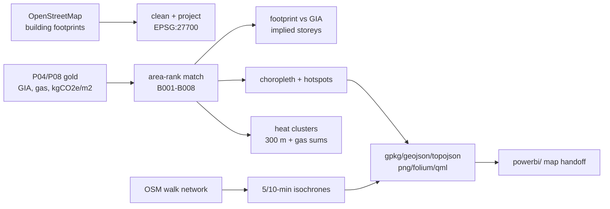

# P19 Spatial analysis and carbon map

> **Synthetic metrics on public geometry. No real building performance is implied.**

## 1. Problem statement

Net-zero and capital programmes need to see *where* energy and carbon sit on the estate: which buildings dominate intensity, which neighbours could share heat, and what sits within walking distance of an intervention. This project joins public OpenStreetMap footprints to synthetic P04/P08 metrics and produces reusable map layers plus a Power BI map-page handoff.

## 2. Architecture



## 3. Data: sources, licences, synthetic-data note

Geometry: OpenStreetMap, © OpenStreetMap contributors, **ODbL** (root `DATA.md`); names anonymised to Building A…. All metrics synthetic (`campus_synth` via gold). Every map carries the "synthetic metrics on public geometry" footnote.

## 4. Quick start (max 3 commands)

```bash
pip install -r projects/p19-spatial-carbon-map/requirements.txt
make p19
```

`make p19` fetches (cached in `data/`) and builds `outputs/` + `powerbi/`.

## 5. Results

Default bbox (Exeter Streatham area, seed 42 gold):

- 1,912 raw footprints → 1,462 kept → **8 matched** (area-rank), 0 storey-flag outliers.
- 4 heat clusters (300 m); biggest gas load cluster 2: **117,375 kWh**.
- 5/10-min isochrones from B004 (largest) via the OSM walk network.
- Outputs: GeoPackage, GeoJSON, TopoJSON, 2 PNGs, Folium HTML, QML style, building-points CSV.

## 6. Design decisions and trade-offs

- **Area-rank matching** (largest footprint ↔ largest GIA) is a documented stand-in for a real address/UPRN join — the honest join in production.
- **Screening-level everything**: clusters are distance-threshold groups, isochrones are convex hulls of reachable nodes — not feasibility, not catchments.
- **Residential OSM clutter dropped** (houses/garages/sheds); campus-adjacent streets stay out of scope by construction.
- Metrics read live warehouse with gold fallback; source recorded per build.

## 7. Data quality and testing approach

- `tests/test_spatial.py` (10 fixtures, offline): validity/emptiness filtering, CRS area vs known 100 m square, distances vs known points, deterministic assignment, storey flags, break monotonicity.
- Geometry validity enforced in the pipeline (`make_valid`, empty-drop); counts logged per run.

## 8. Limitations and next steps with real data

- Footprint ≠ floor area (extensions, courtyards, multi-occupancy); OSM completeness varies — validate against the asset register/UPRNs.
- Single quarter of metrics; isochrones ignore gradients, crossings, opening hours.
- With real data: proper gazetteer join, measured heights/storeys, heat-meter validation of clusters.

## 9. Skills demonstrated

E3 (projected-CRS analysis, OSM networks), E5 (carbon intensity mapping), D5 (map handoff, Folium), D8 (heat-cluster screening, isochrones).
