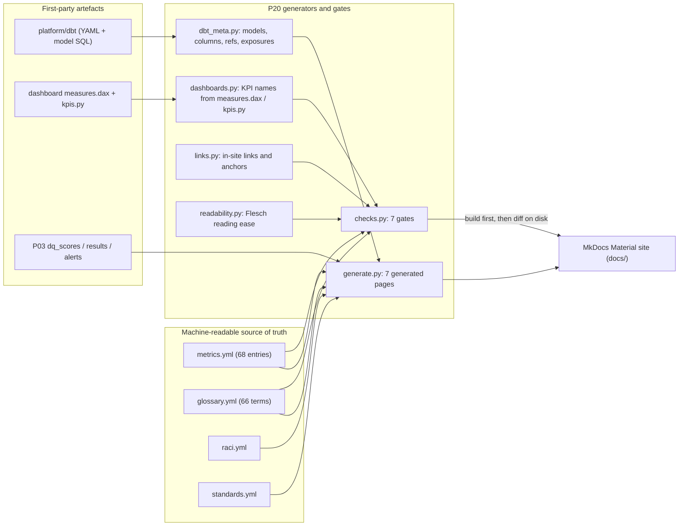

# P20 — Governance and data-literacy pack

> **Synthetic data throughout.** Every building, room, job, meter, sensor and compliance record in this pack comes from the portfolio's generator. Nothing here describes a real university estate, and nothing here is a compliance statement.

## 1. The problem, in plain English

Estate teams are asked the same questions every month: is the space being used, is the plant reliable, are we on track for net zero, are we compliant, and can we tell the board a number we can stand behind. The numbers live in five systems and a lot of memory. Three things go wrong as a result: two teams publish different definitions of the same word, nobody can say who may change a definition, and a reader cannot tell whether to trust a figure. This project is the answer: one governance framework, a data dictionary and glossary built from the actual pipeline, a metric registry that is **tested against the dashboards**, a standards register that says honestly how far we have got, a plain-English guide to every dashboard, and a training pack somebody else can deliver without you in the room.

## 2. Architecture



## 3. Data, licences, synthetic status

| Input | What it is | Licence / access | Used for |
|---|---|---|---|
| `platform/dbt/models/*.yml` and model SQL | first-party repository files | same repository | dictionary and lineage pages |
| `projects/p0X/**/powerbi/measures.dax`, `projects/p07.../src/kpis.py` | first-party dashboard handoff files | same repository | KPI names the registry must cover |
| `data/quality/gold/*.csv` | P03 output in this checkout, from synthetic data | synthetic | DQ score page, DQ column in the glossary |
| `metrics.yml`, `glossary.yml`, `raci.yml`, `standards.yml` | hand-written here | this repository | registry, glossary, RACI and standards pages |

No external dataset is fetched by P20. Standards are **referenced, not reproduced**: the [standards register](docs/generated/standards-register.md) links to the official source (ISO, buildingSMART, NBS, UK BIM Framework, UKRI, DESNZ) and records access terms, which are also in the repository's `DATA.md`. Textstat and MkDocs Material are open-source tooling recorded in `pyproject.toml`.

Everything numeric is synthetic. Read the measured numbers, not the buildings.

## 4. Quick start

```bash
make setup                 # once: installs the project with dev extras (pins textstat 0.7.3)
make p20-run               # build pages, run tests, run every gate, strict site build
```

Wants to read it rather than build it:

```bash
python -m mkdocs serve -f projects/p20-governance-literacy/mkdocs.yml   # http://127.0.0.1:8000/
python projects/p20-governance-literacy/src/cli.py coverage             # KPI coverage report
```

`make p20-run` runs, in order: `p20-build` (regenerate the seven generated pages), `p20-test` (127 tests), `p20-check` (seven gates), `p20-site` (`mkdocs build --strict`).

## 5. Results, measured

| Measure | Result | Where |
|---|---|---|
| Metric registry entries | 74 (69 published on dashboards, 5 planned) | [registry](docs/generated/metric-registry.md) |
| Dashboard KPI names found by scanning | 69 across P06 (12), P07 (24), P08 (9), P09 (9), P10 (7), P11 (9) | `python src/cli.py coverage` |
| Registry and glossary coverage of those KPIs | 69/69, both directions, enforced by tests | `tests/test_registry.py`, `tests/test_glossary.py` |
| Glossary terms | 68, each with owner, source of truth, refresh, DQ score and classification | [glossary](docs/generated/glossary.md) |
| Generated pages | 7, all byte-identical to a fresh build | [generated](docs/generated/) |
| Models and edges in the dictionary and lineage pages | 45 models, 55 edges, 5 exposures | [dictionary](docs/generated/data-dictionary.md), [lineage](docs/generated/lineage.md) |
| In-site links | 107 resolved, 0 broken; external links counted, never fetched | `python src/cli.py links` |
| Literacy pages measured | 15 of 15, Flesch reading ease min **67.4**, mean **76.9** (target 50) | `python src/cli.py readability` |
| Tests | 127 passing | `make p20-test` |
| `mkdocs build --strict` | passes, 32 pages, no warnings | `make p20-site` |
| Coverage of core modules | 96% across the nine P20 modules (see `docs/ACCEPTANCE_P20.md`) | acceptance record |

The three weakest numbers, stated plainly:

1. **P10 publishes its DAX inside `powerbi/model.md` instead of a `measures.dax` file.** The scanner reads that fenced block too, so its seven measures are registered, but only because one extra rule was added and tested: a hand-off written as prose is a hand-off the scanner can miss.
2. **P16 (energy anomalies) is excluded from the KPI scan** because it is mid-build and uncommitted. The exclusion is explicit in `src/config.py` with a reason, and a test fails if a project ships a hand-off without either being scanned or excluded.
3. **External links are not checked.** CI must not depend on the network, so the link checker counts them and the site build stays offline. A dead external URL is found by a human.

## 6. Design decisions and trade-offs

Full table in [ADR and decision index](docs/adr-index.md); the load-bearing ones:

| Decision | Why | Cost |
|---|---|---|
| YAML files as source of truth, pages generated | documentation cannot drift from the pipeline | a generated page is not edited by hand, ever |
| Dictionary from dbt YAML + SQL, not from `manifest.json` | the manifest is a build artefact that is not committed; the YAML is reviewed in pull requests | column descriptions are only as good as the dbt YAML |
| KPI names extracted from `measures.dax`, the DAX fence in `powerbi/model.md`, and `kpis.py` | the registry follows the code that publishes numbers | the DAX rule is a small parser: column-0 definitions, comment definitions, DAX keywords skipped. It is tested on hand-written fixtures. |
| P07 publishes 24 identifiers (12 DAX measures, 12 Python helpers) for the same underlying measures, and `Total Energy kWh` is published by two projects | both artefacts and both reports are real consumers | the paired entries carry a caveat saying so; the shared entry lists both consumers, so the definition cannot drift between reports |
| Cross-project references written as code spans | `mkdocs build --strict` fails on links outside the site, and a broken link is worse than a path in prose | readers of the published site need the repository for those paths |
| Readability gated on the guides only, tables and code stripped | the guides are read by non-specialists; the dictionary is not prose | Flesch is a rough measure, so every measured value is printed and published |
| DQ scores joined from the latest run, "not measured" when absent | a definition without a quality score invites over-trust | pages change when a run changes, which is why staleness is a gate |
| Standards status vocabulary: implemented / mock / awareness-only / not-obtained | stops a placeholder being read as a real mapping (P13 Uniclass is `mock`, SFG20 `not-obtained`) | the register needs upkeep when a standard is obtained |

## 7. Data quality and testing approach

The gates that CI enforces, all run by `python src/cli.py check`:

| Gate | Fails when | Verified by |
|---|---|---|
| metric registry schema | a field is empty, an owner or glossary term is unknown, a consumer does not exist, a live metric has no consumer | `tests/test_registry.py` |
| glossary schema | a refresh value or classification is invalid, a required term is missing, an alias points nowhere | `tests/test_glossary.py` |
| KPI scan scope | a project ships `measures.dax` but is neither scanned nor excluded with a reason | `tests/test_registry.py` |
| KPI coverage, both directions | a dashboard KPI has no registry entry or no glossary definition, or a registry entry publishes nowhere | `tests/test_registry.py`, `tests/test_glossary.py` |
| generated pages not stale | a committed page differs from a fresh render | `tests/test_generators.py` |
| in-site links | a link or heading anchor does not resolve, or points outside the site | `tests/test_links.py` |
| literacy readability | a guide page is missing or scores below Flesch 50 | `tests/test_readability.py` |

Testing style: fixtures first, then the repository. The DAX parser, the dbt YAML/SQL and manifest readers, the page renderers, the link checker and the readability scorer are each tested against hand-written inputs before anything touches the real files, so a failure points at the unit rather than at the estate. Content completeness is tested too (`tests/test_content.py`): every page in the nav, every dashboard guide carrying its question and misreadings, one accountable role per RACI activity, the standards statuses the pack claims, the quiz answering the key, and a synthetic-data statement on every page.

## 8. Limitations and what I would do next with real data

- **No ratified governance.** The roles, owners, service levels and escalation times are a proposal. A real institution signs them off, names people, and pairs them with a data protection contact and a records retention schedule.
- **Compliance frequencies are illustrative.** Nothing here states a legal duty. With real data the compliance owner supplies frequencies from the legal source, and the register records the source and version.
- **HESA/TRAC mapping is illustrative.** The mock return pack's category mapping was written for demonstration. The real specification has to be obtained and encoded before any return is built on it.
- **External links are unchecked offline.** A nightly job with network access should check them.
- **The scan parser is a parser, not a Power BI parser.** Unusual DAX formatting could hide a measure. The scan-scope gate is the safety net: a new dashboard must be scanned, and a test fails when a hand-off file appears unswept.
- **Next steps, in order:** obtain the licensed Uniclass tables and move that standard from `mock` to `implemented`; obtain the HESA EMR specification and encode the mapping with tests; connect the standards register to `DATA.md` automatically so a missing provenance entry fails a gate; add a glossary term's DQ score per dimension rather than per dataset; and run the workshop with a real cohort, then put the measured confidence change in this README.

## 9. Skills demonstrated

| Criterion | Evidence |
|---|---|
| **E7** data governance and documentation | governance framework with roles, RACI, decision rights and escalation; classification and UK GDPR awareness note; naming and modelling standards; standards register with honest status; runbooks; ADR index |
| Promote good practice in data governance, documentation and repeatable workflows | generated dictionary, lineage and DQ pages from the pipeline itself; seven gates in CI; a metric registry tested against the dashboards; the change-control process and log |
| Support training and engagement to improve data literacy | 10-minute demo script, 45-minute workshop with three exercises, answer key, 12-question quiz, feedback form, slide outline, facilitator notes, and a measured readability score for every guide |
| Engineering habits the portfolio asks for | hand-checked fixtures for every validator, ruff and strict MkDocs clean, deterministic generators, documented degradation when inputs are missing, deviations recorded rather than hidden |

## Layout

```
projects/p20-governance-literacy/
  README.md  SPEC.md  Makefile  mkdocs.yml
  metrics.yml (74 entries)  glossary.yml (68 terms)  raci.yml  standards.yml   <- source of truth
  src/    config dashboards metrics glossary dbt_meta generate links readability checks cli
  tests/  conftest test_registry test_glossary test_generators test_links test_readability test_content
  docs/   index.md governance/ data/ standards/ dashboards/ process/ training/ runbooks.md
          adr-index.md reference-index.md generated/ (7 generated pages)
```